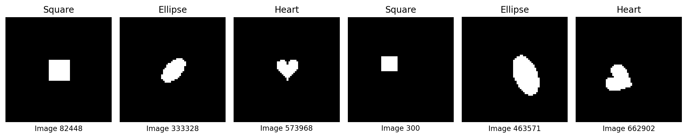
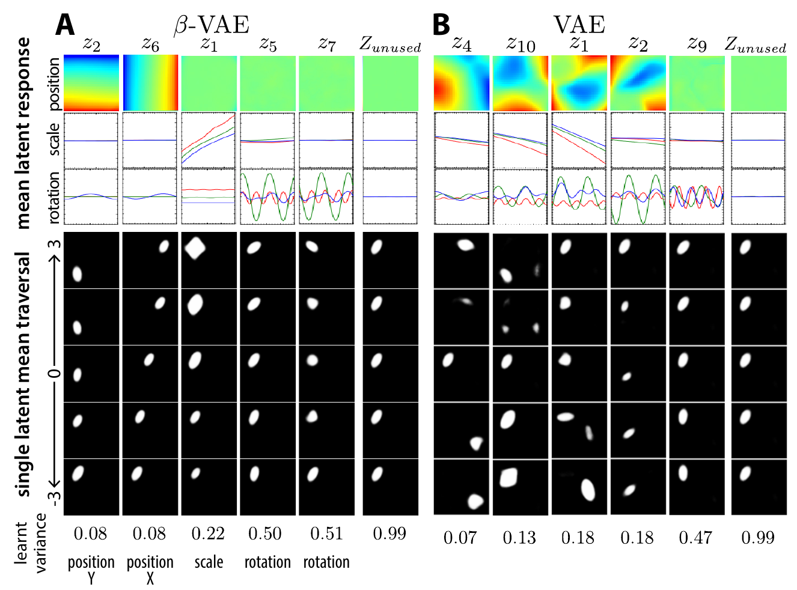
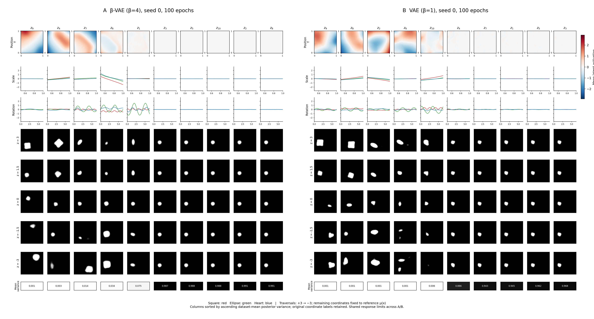
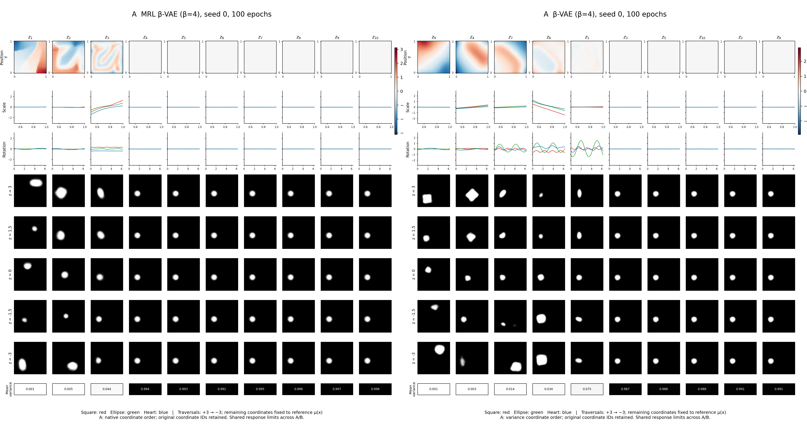
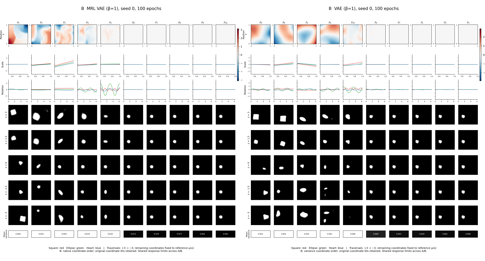
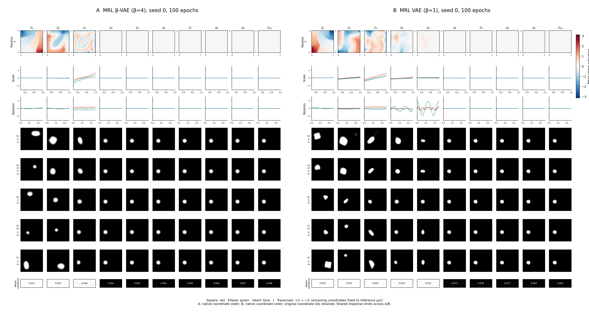
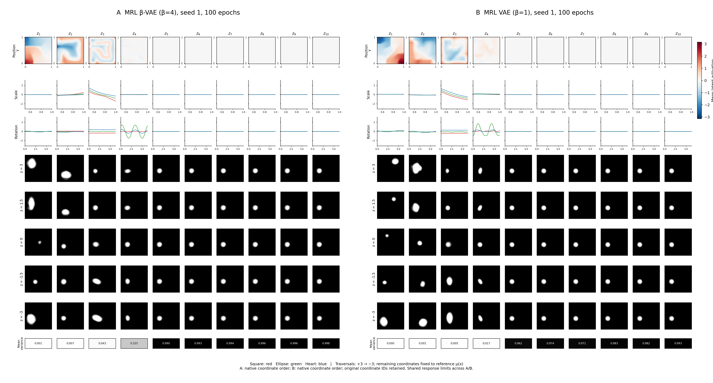
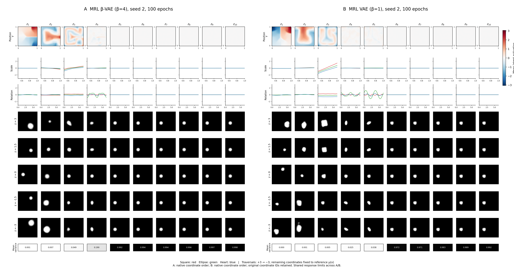
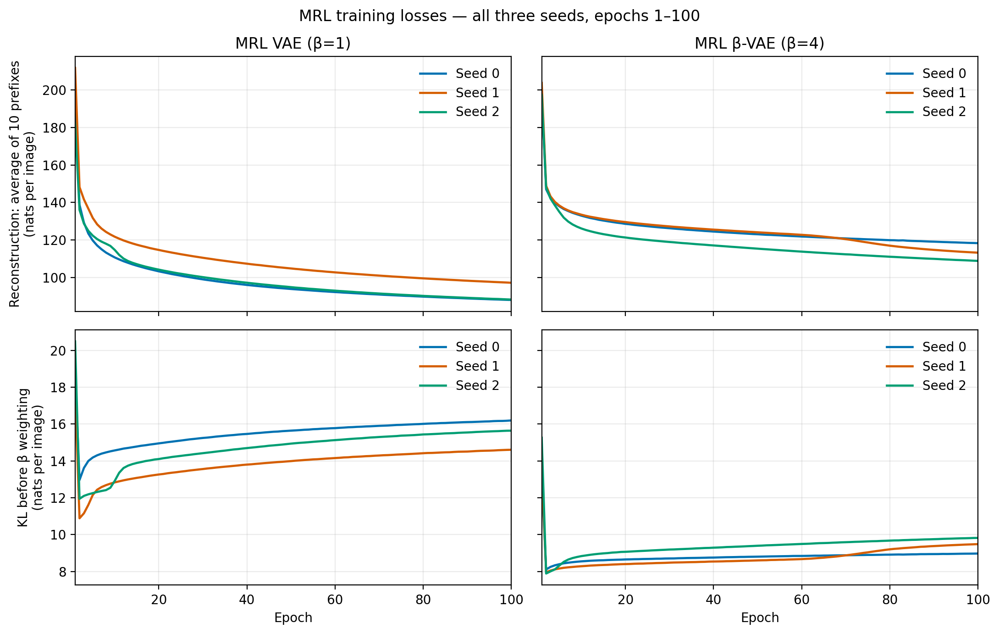
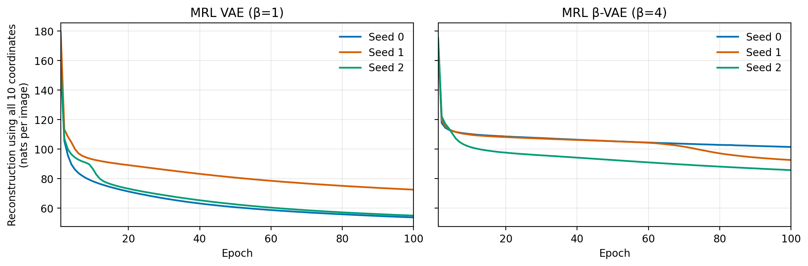

# Meeting report: VAE / β-VAE and reconstruction Matryoshka on dSprites

**Prepared:** 2026-10-14.  
**Meeting date:** To be set.  
**Status:** Initial report with verified numerical results; detailed cross-seed visual analysis pending. Future directions will be curated by Argha.

## Questions we are trying to answer

<span style="color: red;">Can we characterize how task-relevant representation subspaces change between Task A and Task B, and use that change to explain task compatibility, knowledge transfer, or interference? We want to understand whether the geometric relationship between learned representations can tell us how compatible two tasks are for transfer learning.</span>

- **Our idea:** Our assumption: When a model transitions from Task A to Task B, task-relevant information may move or rotate within the latent space. We hypothesize that the magnitude and structure of this movement can reveal how much representational adaptation is required and, consequently, how compatible the two tasks are.

- **Problem:** Neural networks learn representations, but we don't know which dimensions contain important information.

- **MRL's role:** MRL encourages important information to appear in earlier dimensions, creating an ordered representation. Use this ordering to track how information changes when a model learns a new task.

- **Example:** After learning Task A, its information might be accessible in the first 2 dimensions. After learning Task B, it might require 8 dimensions.

1. How does task-relevant information reorganize?
2. How compatible are Tasks A and B?
3. Does this reorganization relate to forgetting?

**Can MRL help us understand how representations change across tasks, and how those changes relate to task compatibility and forgetting?**

## β-VAE: objective and intuition
β-VAE: LEARNING BASIC VISUAL CONCEPTS WITH A
CONSTRAINED VARIATIONAL FRAMEWORK https://www.cs.toronto.edu/~bonner/courses/2022s/csc2547/papers/generative/disentangled-representations/beta-vae,-higgins,-iclr2017.pdf

### Assumptions and the meaning of $z$

The paper describes a dataset $D=\{X,V,W\}$: images $x\in\mathbb R^N$, conditionally independent ground-truth factors $v\in\mathbb R^K$, and conditionally dependent ground-truth factors $w\in\mathbb R^H$. Its stated independence assumption is:

$$
\log p(v\mid x)=\sum_{k=1}^{K}\log p(v_k\mid x).
$$

This means the conditional distribution of $v$ given an image factorizes across its coordinates. The images are assumed to come from a true world simulator:

$$
p(x\mid v,w)=\operatorname{Sim}(v,w).
$$

Training uses **only the images $X$**, without the factor labels $V$ or $W$. The model introduces its own latent vector $z\in\mathbb R^M$, with $M\ge K$, to explain how images are generated. Unlike $v$ and $w$, **$z$ is a representation inferred by the model**, not an observed ground-truth label. The aim is for the decoder's distribution $p_\theta(x\mid z)$ to approximate the simulator's image distribution; ideally, separate coordinates represent the independent factors $v$, while dependent factors $w$ may remain mixed in other coordinates.

We choose an independent standard Gaussian **prior**:

$$
p(z)=\mathcal N(0,I)=\prod_{j=1}^{M}\mathcal N(z_j;0,1).
$$

In our implementation, $M=10$ and the encoder uses a diagonal Gaussian **approximate posterior**:

$$
q_\phi(z\mid x)
=\mathcal N\!\left(\mu_\phi(x),\operatorname{diag}(\sigma_\phi^2(x))\right).
$$


<!-- This does not mean the learned coordinate means are independent across the dataset, or that each coordinate must match one physical factor. Their meanings and ordering are learned, and disentanglement must be evaluated.

The underlying generative goal is to maximize image marginal log-likelihood, with the unobserved $z$ integrated out:

$$
\max_\theta\;\mathbb E_{x\sim p_{\mathrm{data}}}
\left[\log p_\theta(x)\right],
\qquad
p_\theta(x)=\int p_\theta(x\mid z)p(z)\,dz.
$$ -->

<!-- ### Objective and how disentanglement is encouraged -->


Thus, its sampled coordinates are independent **conditional on a fixed image**. . Images are generated by underlying factors such as position, scale, and rotation. A β-VAE learns from images alone: the encoder infers a latent distribution $q_\phi(z\mid x)$, and the decoder reconstructs the image from $z$. A disentangled representation would let individual coordinates describe separate factors, so changing one coordinate changes one property of the image.

The training objective is to minimize:

$$
\mathcal L_{\beta\text{-VAE}}(x)
=
\underbrace{-\mathbb E_{q_\phi(z\mid x)}[\log p_\theta(x\mid z)]}_{\text{reconstruction loss}}
+
\beta\underbrace{D_{\mathrm{KL}}\!\left(q_\phi(z\mid x)\,\|\,\mathcal N(0,I)\right)}_{\text{latent constraint}}.
$$

The reconstruction term encourages $z$ to retain information needed to reproduce the image. The KL term pushes the inferred distribution toward a standard Gaussian prior whose coordinates are independent, while limiting how much information the encoder can carry about each image. Increasing $\beta$ strengthens this constraint. The intuition is that a restricted latent space encourages the model to represent the main sources of image variation with separate coordinates.

At $\beta=1$, this is the ordinary VAE objective; our β-VAE uses $\beta=4$. A stronger constraint can improve factor separation but can also remove useful information and worsen reconstruction. **It encourages disentanglement; it does not guarantee it**, so we assess both the metric and the visual diagnostics.

## First experiment: reproducing the original VAE and β-VAE

We use **dSprites**, a dataset of 737,280 black-and-white images, each 64 × 64 pixels. Each image has one white shape on a black background. The dataset is generated by drawing every combination of three shapes (square, ellipse, heart), six sizes, 40 rotation angles, 32 horizontal positions, and 32 vertical positions:

$$
3\times6\times40\times32\times32=737{,}280.
$$

The dataset records the shape, size, angle, and position of each image. We train the models using only the images. We use these recorded factors afterward to make the plots below.



Six examples from the dataset. The labels below them are their image indices. These are original dataset images, not model reconstructions.

<small>Figure: /home/argha/Mat_embedding/code/NonLinearPB/NonLinearPBMeetingNotes/assets/dsprites_dataset_examples.png</small>

**Paper result: Figure 6 A and B**

The paper's β-VAE has separate position coordinates: horizontal bands for Y and vertical bands for X. The VAE's position maps mix X and Y. Compare these with our result below. **What Figure 6 does:** We ask what each latent coordinate responds to. Every image produces ten encoder means. We average each coordinate separately; we never average all ten coordinates together.

**Position heatmap:** Fix X and Y, say X = 5, Y = 10. Take the 720 dataset images at that position: three shapes × six sizes × 40 angles. For $z_2$, average their 720 values of $\mu_2(x)$. This gives one number for that position. Repeat for all 1,024 positions to make a 32 × 32 table. Display its numbers as colors. In our plots, negative is blue, zero is white, and positive is red; the paper uses a different color scheme. Colors represent encoder means, not position values or pixel brightness. Moving one position step does not mean the latent value increases by one. In the paper, $z_2$ changes mainly with Y and $z_6$ mainly with X, suggesting separate position coordinates. Averaging over other factors can hide their effects, so these maps alone do not prove factor separation.

**Scale curves:** Fix shape = square and choose one size. Take all 40 rotations and 32 × 32 positions: 40,960 images. Average their means for one coordinate, say $\mu_1(x)$, to get one point. Repeat for all six sizes and connect the points. Repeat separately for ellipse and heart. This gives three curves: **red = square, green = ellipse, blue = heart**. We keep shapes separate, rather than averaging all 122,880 images at a given size into one point. In the paper, $z_1$ changes strongly with size for all three shapes, suggesting size information. If the curves differ at the same size, its average response also depends on shape. Overlapping curves would support similar average behavior across shapes, but could still hide differences between individual images.

**Rotation curves:** Fix shape and angle, then average over the six sizes and all 32 × 32 positions: 6,144 images per point. Repeat for all 40 angles. Again, draw one curve per shape. The paper's $z_5$ and $z_7$ respond to rotation.

**Decoded image rows:** Change one coordinate through +3, +1.5, 0, −1.5, −3. Keep the others at one reference image's encoder means, then decode. We see what changing that coordinate does to the image.

**Bottom row and column order:** Average each coordinate's predicted variance over all dataset images. This is the average spread of its distributions, not the variance of its means. Ordinary VAE/β-VAE columns are sorted by this value; MRL columns keep the original order. A coordinate should respond to its factor and remain insensitive to other factors for clean disentanglement.



<small>Figure: /home/argha/Mat_embedding/code/NonLinearPB/NonLinearPBMeetingNotes/assets/paper_figure6_AB_higgins_iclr2017.png. Source: /home/argha/Mat_embedding/files/papers/beta-vae,-higgins,-iclr2017.pdf, page 9, Figure 6 panels A and B.</small>


**Our result: Figure 6 A and B**



We trained an ordinary VAE ($\beta=1$) and a β-VAE ($\beta=4$) on dSprites for 100 epochs, using seed 0 and the original Adagrad/Tanh/default-initialization setup. Figure 6 below compares their learned coordinates side by side: **A, β-VAE on the left; B, VAE on the right**.

- **What we see:** In β-VAE, the position maps for $z_9$ and $z_4$ are diagonal, so X and Y are still mixed. Coordinates such as $z_7$ and $z_6$ respond to both size and rotation. Several other coordinates barely affect the image. The VAE also mixes position, size, and appearance. This seed does not show clean separation of the factors.

<small>Figure: /home/argha/Mat_embedding/files/results/test_runs/exprmnt_2026_10_12__21_51_46/figure6_AB_2026_10_13__13_24_54.png</small>


<!-- 1. Does requiring every leading latent prefix to reconstruct the image improve factor organization relative to ordinary VAE training?
2. How does reconstruction Matryoshka interact with the stronger KL penalty of $\beta=4$, compared with $\beta=1$?
3. Do independent training seeds agree about what the same native coordinate $z_i$ represents and its position in the learned ordering?
4. Does the scalar disentanglement metric agree with the factor-response maps, reconstructions, and latent traversals?

All four models are unsupervised. Factor labels are used for evaluation, not to train the representations. Ordered reconstruction utility is the source of Matryoshka pressure in this experiment.


## Matryoshka results: seed 0

We use **seed 0 only** for both comparisons below. All four models trained for 100 epochs with the same Adagrad/Tanh setup. Matryoshka asks each leading prefix of the latent vector to reconstruct the image: first $z_1$, then $(z_1,z_2)$, and so on up to all ten coordinates, using one shared decoder.

MRL columns stay in the original order $z_1,\ldots,z_{10}$. Ordinary-model columns are sorted by average variance. Read the coordinate labels; the same column number does not mean the same coordinate or factor across models. The existing plots also use different color ranges, so compare patterns rather than color intensity.

### MRL β-VAE versus β-VAE

**Left: MRL β-VAE. Right: ordinary β-VAE. Both use $\beta=4$.**



<small>Figure: /home/argha/Mat_embedding/code/NonLinearPB/NonLinearPBMeetingNotes/assets/figure6_seed0_mrl_beta_vae_versus_beta_vae.png</small>

- **What we see:** MRL β-VAE puts most visible responses in $z_1,z_2,z_3$. The first two respond mainly to position, but their maps still mix X and Y. The third responds strongly to size and also has a position response. Rotation responses are weak. Coordinates $z_4$–$z_{10}$ barely change the decoded image and have variances near one. Ordinary β-VAE has about five active coordinates and more visible rotation responses, but those coordinates also mix factors. MRL concentrates information earlier; this figure does not show clean factor separation, and it suggests that rotation information is reduced.

### MRL VAE versus VAE

**Left: MRL VAE. Right: ordinary VAE. Both use $\beta=1$.**



<small>Figure: /home/argha/Mat_embedding/code/NonLinearPB/NonLinearPBMeetingNotes/assets/figure6_seed0_mrl_vae_versus_vae.png</small>

- **What we see:** MRL VAE puts most visible responses in the first five coordinates. Position responds most clearly in the early coordinates; rotation responds most clearly in $z_4$ and $z_5$. Size affects several coordinates, especially $z_3$. The position maps remain mixed, and traversals change more than one property. Ordinary VAE also has about five active coordinates, displayed first because of variance sorting. We see information placed in early native coordinates for MRL, but not a clear one-factor-per-coordinate representation. We need the other seeds to judge whether this pattern is stable.

<small>Source panels: /home/argha/Mat_embedding/files/results/exprmnt_2026_10_13__21_22_10/figure6/matryoshka/seed_0/figure6_A_beta_vae_2026_10_13__23_46_09.png; /home/argha/Mat_embedding/files/results/exprmnt_2026_10_13__21_22_10/figure6/ordinary/seed_0/figure6_A_beta_vae_2026_10_13__21_43_21.png; /home/argha/Mat_embedding/files/results/exprmnt_2026_10_13__21_22_10/figure6/matryoshka/seed_0/figure6_B_vae_2026_10_13__23_46_09.png; /home/argha/Mat_embedding/files/results/exprmnt_2026_10_13__21_22_10/figure6/ordinary/seed_0/figure6_B_vae_2026_10_13__21_43_21.png.</small> -->


## MRL reproducibility across seeds 0, 1, and 2

Here we ask: **If we train the same MRL model again with another seed, do the same coordinates learn the same things?** A different seed changes the initial weights and training randomness. The data, model settings, and 100-epoch training budget stay the same.

Each figure shows **MRL β-VAE on the left and MRL VAE on the right**. All columns keep the original order $z_1,\ldots,z_{10}$, so we can compare the same coordinate across seeds. Look at the patterns and curves; each figure has its own color range.





<small>Figure: /home/argha/Mat_embedding/files/results/exprmnt_2026_10_13__21_22_10/figure6/matryoshka/seed_0/figure6_AB_2026_10_13__23_46_09.png</small>
<small>Figure: /home/argha/Mat_embedding/files/results/exprmnt_2026_10_13__21_22_10/figure6/matryoshka/seed_1/figure6_AB_2026_10_14__02_09_13.png</small>
<small>Figure: /home/argha/Mat_embedding/files/results/exprmnt_2026_10_13__21_22_10/figure6/matryoshka/seed_2/figure6_AB_2026_10_14__04_33_01.png</small>

### What repeats, and what changes?

- **Position:** In both MRL models, $z_1$ and $z_2$ respond strongly to position in all three seeds. But their maps change direction and shape, and still mix X and Y. We do not get one consistent X coordinate and one consistent Y coordinate.
- **Size:** $z_3$ has a strong size response in both models for all three seeds. Its curve rises in seeds 0 and 2, but falls in seed 1. A sign reversal still lets a coordinate represent size; however, its position map also varies, so it is not a pure size coordinate.
- **Rotation:** MRL β-VAE has little rotation response in seed 0, but a visible response in $z_4$ for seeds 1 and 2. MRL VAE has rotation responses mainly in $z_4$ and $z_5$ for seeds 0 and 2, and mainly in $z_4$ for seed 1. Rotation is less stable across training runs.
- **Later coordinates:** Responses are mostly concentrated in $z_1$–$z_4$ for MRL β-VAE and $z_1$–$z_5$ for MRL VAE. The remaining coordinates have nearly flat curves, variances near one, and little effect in the decoded traversals. The number of visibly active coordinates changes slightly across seeds.
- **What this tells us:** The broad ordering repeats: position appears early, size responds strongly in $z_3$, and rotation appears later when retained. Exact coordinate behavior does not repeat, and the factors remain mixed. These three seeds support a similar early-coordinate pattern, not a fully reproducible, cleanly separated representation.

## Fundamental Mathematical Problem

1. **Pretraining provides latent representations.**
   - Neural networks learn representations of the underlying data. Disentanglement methods may help recover meaningful factors. However, the true generative factors are not necessarily uniquely identifiable.

2. **We want to measure task compatibility through geometric changes.**
   - Compare the representations associated with Task A and Task B. Hypothesize that their geometric relationship reflects transfer compatibility. This relationship has not yet been established.

3. **Our proposed geometric transformation assumes linearity.**
   - Neural representations may be related through nonlinear transformations. Klindt's framework provides linear identifiability under specific restrictive assumptions. Therefore, linearity cannot be assumed universally.

4. **Learned representations are stochastic and seed-dependent.**
   - Different random seeds may produce different latent organizations. Two models can encode similar information using different coordinate systems. MRL imposes an ordering but does not guarantee identical directions across seeds.


Suppose two representations are linearly related to the underlying factors:

$$
r_A = \Phi_A v
$$

$$
r_B = \Phi_B v
$$

Even if both representations are linearly identifiable, the transformations $\Phi_A$ and $\Phi_B$ need not be unique or orthogonal.

An arbitrary invertible transformation can change geometric properties without changing the information represented.

Therefore:

$$
\boxed{\text{Geometric similarity} \neq \text{Task compatibility}}
$$

At least, not without additional assumptions.

**MRL does not automatically solve this identifiability problem.** It introduces coordinate ordering but does not guarantee unique, reproducible latent directions.

## 4. Two Possible Research Directions

### Direction A: Theoretical

- Identify conditions under which task-relevant subspaces are identifiable.
- Establish when their geometric relationships are meaningful.
- Investigate whether those relationships predict or constrain transfer compatibility.

### Direction B: Empirical

- Measure task compatibility directly through transfer performance.
- Learn Matryoshka-ordered representations for different tasks.
- Measure geometric relationships between their representations.
- Test whether geometry predicts transfer performance across tasks and random seeds.

<!-- **Preferred starting point:** Direction B, because it does not assume the relationship we are trying to establish.


**Does the geometry of Matryoshka-ordered representations reliably predict transfer-learning compatibility across tasks and random seeds?**

A negative result would also be scientifically meaningful.


Before developing a geometric compatibility measure, we must define:

**What makes Task A and Task B compatible, independently of their learned representations?**

Until we establish an operational definition of task compatibility, we cannot determine whether geometric measurements are valid indicators of it. -->


## MRL losses over training: all three seeds

We have one saved loss record for every epoch from 1 to 100, for both $\beta=1$ and $\beta=4$, and seeds 0, 1, and 2. Each point averages the per-image losses measured during that epoch. These are training losses, not validation losses or a new evaluation of the final checkpoint. The curves are not smoothed.



<small>Figure: /home/argha/Mat_embedding/code/NonLinearPB/NonLinearPBMeetingNotes/assets/mrl_epoch_reconstruction_and_kl_all_seeds.png</small>

- **Top row:** Reconstruction loss averaged over the ten prefixes. For each image, each prefix predicts all 4,096 pixels; we average the ten reconstruction losses. Lower is better.
- **Bottom row:** KL for the full posterior, before multiplying by $\beta$. The actual KL contribution to the loss is $\beta$ times this value. Both losses are measured in nats per image.
- **What we see:** Reconstruction improves quickly at first, then more slowly. It is still decreasing at epoch 100. KL drops early, then gradually rises as reconstruction improves. The $\beta=4$ models keep a smaller KL but have larger reconstruction losses than the $\beta=1$ models. This shows the trade-off: a stronger latent constraint comes with worse reconstruction. Seeds follow the same broad pattern but finish at different values.

The plot below shows reconstruction using **all ten coordinates only**, rather than averaging the prefixes. This separates the full-vector reconstruction from the extra difficulty of reconstructing with short prefixes.



<small>Figure: /home/argha/Mat_embedding/code/NonLinearPB/NonLinearPBMeetingNotes/assets/mrl_epoch_full_reconstruction_all_seeds.png</small>

| Model | Seed | Epoch-100 average-prefix reconstruction | Epoch-100 full-vector reconstruction | Epoch-100 KL before weighting |
|---|---:|---:|---:|---:|
| MRL VAE, $\beta=1$ | 0 | 87.97 | 53.63 | 16.19 |
| MRL VAE, $\beta=1$ | 1 | 97.16 | 72.45 | 14.60 |
| MRL VAE, $\beta=1$ | 2 | 88.21 | 54.86 | 15.64 |
| MRL β-VAE, $\beta=4$ | 0 | 118.29 | 101.42 | 8.97 |
| MRL β-VAE, $\beta=4$ | 1 | 113.20 | 92.57 | 9.48 |
| MRL β-VAE, $\beta=4$ | 2 | 108.82 | 85.70 | 9.82 |

All 600 epoch records, including weighted KL, total loss, and each prefix's reconstruction loss: `/home/argha/Mat_embedding/code/NonLinearPB/NonLinearPBMeetingNotes/assets/mrl_epoch_losses_all_seeds.csv`.

## Actual architecture and loss calculation

This is what our PyTorch code does for the ordinary VAE, β-VAE, and both MRL models. They use the same encoder and decoder. MRL changes how we use the latent vector and calculate reconstruction loss.

### 1. Input and encoder

An input image has 64 × 64 binary pixels: white is 1 and black is 0. Flatten it into a vector $x$ with 4,096 values. A fully connected (FC) layer connects every input value to every output neuron.

$$
x\in\mathbb R^{4096}
\longrightarrow \mathrm{FC}(4096,1200)+\mathrm{ReLU}
\longrightarrow \mathrm{FC}(1200,1200)+\mathrm{ReLU}
\longrightarrow h\in\mathbb R^{1200}.
$$

ReLU replaces negative values with zero. From the shared hidden vector $h$, two separate linear layers produce:

$$
\mu=W_\mu h+b_\mu\in\mathbb R^{10},
\qquad
\ell=W_\ell h+b_\ell\in\mathbb R^{10},
\qquad \ell_j=\log\sigma_j^2.
$$

There is no ReLU on these outputs. The means and log-variances can be any real numbers. We predict log-variance so that $\sigma_j^2=\exp(\ell_j)$ is positive. The encoder produces **20 distribution parameters: ten means and ten log-variances**, not a 20-dimensional latent vector. Each image gets its own parameters. Training learns the network weights that produce them.

### 2. Sample a ten-dimensional latent vector

For each image during training, draw ten independent standard Gaussian noise values:

$$
\epsilon\sim\mathcal N(0,I),
\qquad
z_j=\mu_j+\exp(\ell_j/2)\epsilon_j.
$$

The square root of variance is the standard deviation: $\sigma_j=\exp(\ell_j/2)$. For example, if $\mu_j=2$, $\sigma_j=0.5$, and $\epsilon_j=-1$, then $z_j=1.5$. This sampling formula lets gradients reach the encoder through $\mu$ and $\sigma$. We use one sampled vector per image in each training forward pass. For the reconstruction grids, we use $z=\mu$ instead, giving a repeatable reconstruction without sampling noise.

### 3. Decoder and Bernoulli pixels

$$
z\in\mathbb R^{10}
\longrightarrow \mathrm{FC}(10,1200)+\mathrm{Tanh}
\longrightarrow \mathrm{FC}(1200,1200)+\mathrm{Tanh}
\longrightarrow \mathrm{FC}(1200,1200)+\mathrm{Tanh}
\longrightarrow \mathrm{FC}(1200,4096).
$$

Tanh is used in the three hidden layers. The final layer has no Tanh. It outputs 4,096 **logits**, one real number $a_i$ per pixel. A sigmoid turns each logit into the probability that the pixel is white:

$$
\pi_i=\operatorname{sigmoid}(a_i),
\qquad p_\theta(x_i\mid z)=\pi_i^{x_i}(1-\pi_i)^{1-x_i}.
$$

We assume pixels are conditionally independent given $z$, so their probabilities multiply. A predicted probability of 0.8 means an 80% chance of white. Our displayed reconstructions show these probabilities as gray levels; we do not sample a black-or-white value for each displayed pixel.

### 4. Reconstruction loss: binary cross-entropy

For one image, take the negative log-probability of its actual pixels:

$$
R(x,z)=-\log p_\theta(x\mid z)
=-\sum_{i=1}^{4096}\left[x_i\log\pi_i+(1-x_i)\log(1-\pi_i)\right].
$$

For a white pixel, the loss is $-\log\pi_i$. For a black pixel, it is $-\log(1-\pi_i)$. If a white pixel gets probability 0.9, its loss is about 0.105; if it gets probability 0.1, its loss is about 2.303. Wrong confident predictions cost more.

**Sum over all 4,096 pixels, then average over the images in the batch. We do not average over pixels.** The code uses `binary_cross_entropy_with_logits`, which calculates this directly from logits in a numerically stable way. One sampled $z$ estimates the reconstruction expectation during training. Natural logarithms give units of nats per image.

### 5. KL loss: compare the posterior with the prior

The encoder's distribution is $q_\phi(z\mid x)=\mathcal N(\mu,\operatorname{diag}(\sigma^2))$. The prior is $p(z)=\mathcal N(0,I)$. For one image:

$$
K(x)=D_{\mathrm{KL}}(q_\phi(z\mid x)\|p(z))
=\frac12\sum_{j=1}^{10}
\left[\mu_j^2+\exp(\ell_j)-1-\ell_j\right].
$$

This formula is calculated exactly; we do not estimate KL from the sampled $z$. It follows from $D_{\mathrm{KL}}=\mathbb E_q[\log q-\log p]$, using $\mathbb E_q[(z_j-\mu_j)^2]=\sigma_j^2$ and $\mathbb E_q[z_j^2]=\sigma_j^2+\mu_j^2$.

For one coordinate, $\mu_j=0$ and $\sigma_j^2=1$ give zero KL. If $\mu_j=0.5$ and $\sigma_j^2=0.25$, its KL is about 0.443 nats. Sum the contributions of all ten coordinates, then average over batch images. This discourages the inferred distributions from moving too far from the prior; it does not by itself guarantee separate physical factors.

### 6. Ordinary VAE and β-VAE loss

For a batch of $B$ images:

$$
\mathcal L=\frac1B\sum_{b=1}^{B}\left[R(x_b,z_b)+\beta K(x_b)\right].
$$

VAE uses $\beta=1$; β-VAE uses $\beta=4$. As an illustration, if average reconstruction loss is 100 and average KL is 10, total loss is 110 for $\beta=1$ and 140 for $\beta=4$. These are example numbers, not measured results. The plotted KL curves show $K$, before multiplication by $\beta$.

### 7. MRL loss: reconstruct from every leading prefix

Encode each image once and sample one full vector $z$. For each $k=1,\ldots,10$, keep the first $k$ coordinates and replace the rest with zeros:

$$
\widetilde z^{(k)}=(z_1,\ldots,z_k,0,\ldots,0).
$$

Send each masked vector through the **same decoder** and compare it with the **same original image**. Average the ten scalar reconstruction losses, then add one KL penalty for the full posterior:

$$
\mathcal L_{\mathrm{MRL}}
=\frac1B\sum_{b=1}^{B}
\left[\frac1{10}\sum_{k=1}^{10}R(x_b,\widetilde z_b^{(k)})+\beta K(x_b)\right].
$$

We reuse the same sampled $z$ for all prefixes. We average losses, not reconstructed images. We do not add KL ten times. Gradients from all prefixes and the one KL term are accumulated, then the optimizer updates once per batch. MRL VAE uses $\beta=1$ and MRL β-VAE uses $\beta=4$. All four models train without factor labels. There is no capacity schedule in this comparison.

### 8. Training and evaluation settings

This table describes the current four-condition, three-seed comparison. Earlier experiments used different configurations, summarized below; their full folder paths are recorded in Technical details.

| Setting | Value |
|---|---|
| Model seeds | 0, 1, 2 per condition |
| Fixed KL multiplier | $\beta=1$ or $\beta=4$ |
| Training | 100 epochs; batch 256; 288,000 updates/model |
| Optimizer | Adagrad, LR 0.01; epsilon $10^{-10}$; initial accumulator 0; no explicit LR decay or weight decay |
| Model selection | Final epoch-100 checkpoint; checkpoints also every ten epochs |
| Schedules/extra regularization | None; no KL warm-up or capacity schedule |
| Metric representation | Frozen full posterior mean, ten coordinates |
| Metric examples | 10,000 train / 2,000 validation / 5,000 test |
| Pair aggregation | 64 pairs/example; average absolute mean differences |
| Metric sampling seeds | 1729 / 1730 / 1731 |
| Classifier | Linear 10→4 with bias; softmax cross-entropy |
| Classifier optimizer | Adagrad, LR 0.01; batch 256 |
| Classifier seeds | 0, 1, 2 for each model seed |
| Classifier selection | Best validation CE; cap 2,000 epochs; patience 20; minimum improvement $10^{-4}$ |
| Score aggregation | All nine scores/condition; no filtering |
| Figure 6 | MRL native order; ordinary variance order; reference image 19477; five traversal values from $+3$ to $-3$ |
| Other diagnostics | Training curves, full-mean reconstruction grids, four reference traversals using empirical 5th–95th percentiles, per-factor accuracies and confusion matrices |

### Completed numerical analysis

Training and the existing evaluation pipeline completed for all four conditions and three model seeds. Each trained encoder was evaluated with three classifier initializations. All nine scores per condition were retained; none were discarded.

The reported metric is a linear classifier's accuracy at identifying **which factor was held fixed** between image pairs: X-position, Y-position, scale, or rotation. It is not factor-value prediction accuracy or the fraction of disentangled coordinates. Chance accuracy is 25%.

| Condition | Model seed 0 mean | Model seed 1 mean | Model seed 2 mean | All nine scores mean |
|---|---:|---:|---:|---:|
| VAE, $\beta=1$ | 76.93% | 77.69% | 86.83% | **80.48%** |
| β-VAE, $\beta=4$ | 92.06% | 60.68% | 78.91% | **77.22%** |
| MRL VAE, $\beta=1$ | 82.29% | 82.50% | 86.76% | **83.85%** |
| MRL β-VAE, $\beta=4$ | 84.07% | 83.42% | 67.21% | **78.23%** |

Each seed-level mean averages three classifier fits of one frozen encoder. The overall mean averages all nine fits. There are three independently trained models per condition, not nine.

The unfiltered mean increases by approximately 3.37 percentage points for MRL VAE and 1.02 percentage points for MRL β-VAE relative to their ordinary counterparts. Individual seed comparisons differ, especially for the stronger KL penalty; an aggregate increase does not establish consistent improvement or coordinate stability.

Sources: aggregate summary: `/home/argha/Mat_embedding/files/results/exprmnt_2026_10_13__21_22_10/aggregate/summary.json`, all 36 raw scores: `/home/argha/Mat_embedding/files/results/exprmnt_2026_10_13__21_22_10/aggregate/all_36_scores.json`, and paired model-seed differences: `/home/argha/Mat_embedding/files/results/exprmnt_2026_10_13__21_22_10/aggregate/paired_model_seed_differences.csv`.

### Earlier experiments: numerical context

Before the current three-seed matrix, we completed these single-model-seed pilots. Every mean below averages three metric-classifier initializations of **one** encoder; these are not three-model-seed results.

| Earlier condition | Training setup | Epochs | Mean metric accuracy |
|---|---|---:|---:|
| Ordinary VAE, $\beta=1$ | Adagrad / Tanh / default initialization | 100 | 76.93% |
| Ordinary β-VAE, $\beta=4$ | Adagrad / Tanh / default initialization | 100 | 92.06% |
| Ordinary VAE, $\beta=1$ | Adam / ReLU / Xavier initialization | 100 | 83.01% |
| Capacity-controlled VAE | Adam / ReLU / Xavier; $\gamma=1000$, capacity rising to 25 nats | 100 | 98.49% |

The capacity model used a different loss from fixed-$\beta$ training and is not part of the current four-condition matrix. Its earlier reconstructions were blurry and traversals mixed properties despite the high scalar score. The Adam/ReLU/Xavier VAE and capacity model share one parent comparison folder; the earlier Adagrad VAE and β-VAE each have separate parent folders.

The initial two-epoch, full-data Adagrad trial scored 96.79% for VAE and 95.75% for β-VAE, using a classifier cap of 200 rather than 2,000. Those exploratory scores do not represent the completed 100-epoch models. The initial untrained control scored 38.75% under the 200-epoch classifier cap.

All historical numbers above are unfiltered means from saved summaries. Original historical files also contain best-half statistics; this report does not use those filtered values. Full paths and the interrupted/resumed VAE history appear at the end of this report.

<!-- ### Figure and diagnostic analysis: pending

Six Figure 6 A/B comparisons, reconstruction grids, training curves, and four reference traversals per model have been generated. Their detailed cross-seed interpretation has not yet been completed for this full experiment.

For MRL Figure 6, columns retain the original order $z_1,\ldots,z_{10}$. This permits native ranking and same-coordinate seed comparisons. Ordinary-model figures retain variance sorting, with coordinate IDs displayed. Sorting the ordinary figures must not be confused with a learned ranking.

Seed 0 model comparisons and all three MRL seed figures have now been visually reviewed above. Review of the other diagnostics is still pending. No claim of clean factor separation, reproducible coordinates, or nonlinear identifiability follows from the score table alone.

### Current limitations

- All 36 classifier fits reached their 2,000-epoch cap. We used validation-selected weights, but classifier convergence remains unresolved.
- Three model seeds provide a small variability sample. Classifier repetitions do not replace additional trained-model replicas.
- Metric examples use the same underlying image archive as unsupervised training, so this measures representation organization on that archive rather than unseen-image generalization.
- No score filtering was used; these summaries differ from the original paper's best-half reporting protocol.
 -->


## Summary

The full experiment executed successfully. Reconstruction Matryoshka produces modest increases in the unfiltered average metric score, with seed-dependent outcomes. The stronger-KL models show substantial variability across training seeds.

The three-seed MRL figures show a repeated broad ordering: early position responses, a strong size response in the third coordinate, and later rotation responses when retained. Exact coordinate behavior varies, and factors remain mixed; this does not establish fully stable factor separation. The numerical metric and its optimization limitations should be discussed alongside the visual evidence.

## Future directions

**To be curated by Argha after reviewing the results and discussing them with the professors.**

No new experiment or method choice is committed by this section.

## Technical details

### Experiment identity and folders

- Experiment: three-seed ordinary VAE / β-VAE versus reconstruction Matryoshka.
- Main experiment name: `exprmnt_2026_10_13__21_22_10`; full path: `/home/argha/Mat_embedding/files/results/exprmnt_2026_10_13__21_22_10/`.
- Results root: `/home/argha/Mat_embedding/files/results/exprmnt_2026_10_13__21_22_10`.
- Manifest of all runs, checkpoints, and figures: `/home/argha/Mat_embedding/files/results/exprmnt_2026_10_13__21_22_10/manifest.json`.
- Complete experiment plan: `/home/argha/Mat_embedding/code/NonLinearPB/plans/dsprites_vae_beta_vae_matryoshka_three_seed_plan.md`.
- Runtime: 25,867.038 seconds, approximately 7 hours 11 minutes.
- Status: 12 models completed 100 epochs each; 36 classifier fits and six combined Figure 6 comparisons completed.

The folder shown directly inside the results directory is the **parent comparison folder**, `/home/argha/Mat_embedding/files/results/exprmnt_2026_10_13__21_22_10/`. The timestamped folders below are **nested child runs inside that parent**, not separate experiments beside it. The matrix workflow starts a separate training entry point for each condition/seed; that entry point creates its own timestamped child folder.

These paths were read from `/home/argha/Mat_embedding/files/results/exprmnt_2026_10_13__21_22_10/manifest.json` and checked against the filesystem. All twelve directories exist. Earlier capacity-control and initial-pilot results are separate runs; they are not the sources of this report.

| Condition | Model seed | Full child-run path |
|---|---:|---|
| `vae` | 0 | `/home/argha/Mat_embedding/files/results/exprmnt_2026_10_13__21_22_10/conditions/vae/seed_0/exprmnt_2026_10_13__21_22_11` |
| `vae` | 1 | `/home/argha/Mat_embedding/files/results/exprmnt_2026_10_13__21_22_10/conditions/vae/seed_1/exprmnt_2026_10_13__23_46_27` |
| `vae` | 2 | `/home/argha/Mat_embedding/files/results/exprmnt_2026_10_13__21_22_10/conditions/vae/seed_2/exprmnt_2026_10_14__02_09_31` |
| `beta_vae` | 0 | `/home/argha/Mat_embedding/files/results/exprmnt_2026_10_13__21_22_10/conditions/beta_vae/seed_0/exprmnt_2026_10_13__21_22_11` |
| `beta_vae` | 1 | `/home/argha/Mat_embedding/files/results/exprmnt_2026_10_13__21_22_10/conditions/beta_vae/seed_1/exprmnt_2026_10_13__23_46_27` |
| `beta_vae` | 2 | `/home/argha/Mat_embedding/files/results/exprmnt_2026_10_13__21_22_10/conditions/beta_vae/seed_2/exprmnt_2026_10_14__02_09_31` |
| `mrl_vae` | 0 | `/home/argha/Mat_embedding/files/results/exprmnt_2026_10_13__21_22_10/conditions/mrl_vae/seed_0/exprmnt_2026_10_13__21_43_39` |
| `mrl_vae` | 1 | `/home/argha/Mat_embedding/files/results/exprmnt_2026_10_13__21_22_10/conditions/mrl_vae/seed_1/exprmnt_2026_10_14__00_07_51` |
| `mrl_vae` | 2 | `/home/argha/Mat_embedding/files/results/exprmnt_2026_10_13__21_22_10/conditions/mrl_vae/seed_2/exprmnt_2026_10_14__02_30_53` |
| `mrl_beta_vae` | 0 | `/home/argha/Mat_embedding/files/results/exprmnt_2026_10_13__21_22_10/conditions/mrl_beta_vae/seed_0/exprmnt_2026_10_13__21_43_39` |
| `mrl_beta_vae` | 1 | `/home/argha/Mat_embedding/files/results/exprmnt_2026_10_13__21_22_10/conditions/mrl_beta_vae/seed_1/exprmnt_2026_10_14__00_07_51` |
| `mrl_beta_vae` | 2 | `/home/argha/Mat_embedding/files/results/exprmnt_2026_10_13__21_22_10/conditions/mrl_beta_vae/seed_2/exprmnt_2026_10_14__02_30_53` |

### Previous experiment folders

These are earlier runs under the main results directory, separate from the current parent `/home/argha/Mat_embedding/files/results/exprmnt_2026_10_13__21_22_10/`. The listed paths were verified against saved configs, summaries, manifests, and the filesystem.

| Earlier experiment | Full results-folder path | Contents/status |
|---|---|---|
| Initial VAE / β-VAE trial | `/home/argha/Mat_embedding/files/results/test_runs/exprmnt_2026_10_12__21_51_46/` | Both models, two full-data epochs, model seed 0; classifier cap 200. Later-added Figure 6 files in this folder use the separate 100-epoch checkpoints below, not this trial's weights. |
| Initial untrained VAE control | `/home/argha/Mat_embedding/files/results/test_runs/exprmnt_2026_10_12__22_17_14/` | No encoder/decoder optimization; only classifiers trained, cap 200. |
| Original VAE launch, interrupted | `/home/argha/Mat_embedding/files/results/exprmnt_2026_10_12__22_22_49/` | Preserved partial VAE training and untrained control; epoch-10 checkpoint supplied recovery. This is not the completed VAE run. |
| Completed original β-VAE, $\beta=4$ | `/home/argha/Mat_embedding/files/results/exprmnt_2026_10_12__22_22_53/` | 100 epochs, seed 0, Adagrad/Tanh/default; mean score 92.06%. |
| Completed original VAE, $\beta=1$ | `/home/argha/Mat_embedding/files/results/exprmnt_2026_10_12__22_29_14/` | Resumed from epoch 10 of the interrupted run, completed 100 total epochs; mean score 76.93%. |
| Repo-inspired VAE + capacity comparison | `/home/argha/Mat_embedding/files/results/exprmnt_2026_10_13__14_52_36/` | Parent comparison folder for 100-epoch Adam/ReLU/Xavier VAE and capacity model; includes their Figure 6 A/B and combined summary. |

The repo-inspired comparison has these nested model runs:

- Ordinary VAE run: `/home/argha/Mat_embedding/files/results/exprmnt_2026_10_13__14_52_36/vae_runs/exprmnt_2026_10_13__14_52_38/`.
- Ordinary VAE checkpoint: `/home/argha/Mat_embedding/files/results/exprmnt_2026_10_13__14_52_36/vae_runs/exprmnt_2026_10_13__14_52_38/beta_1_seed_0/checkpoint_final.pt`.
- Capacity model run: `/home/argha/Mat_embedding/files/results/exprmnt_2026_10_13__14_52_36/beta_vae_runs/exprmnt_2026_10_13__14_52_38/`.
- Capacity model checkpoint: `/home/argha/Mat_embedding/files/results/exprmnt_2026_10_13__14_52_36/beta_vae_runs/exprmnt_2026_10_13__14_52_38/capacity_seed_0/checkpoint_final.pt`.
- Historical comparison manifest: `/home/argha/Mat_embedding/files/results/exprmnt_2026_10_13__14_52_36/manifest.json`.
- Historical comparison Figure 6 folder: `/home/argha/Mat_embedding/files/results/exprmnt_2026_10_13__14_52_36/figure6/`.

The folder name `beta_vae_runs` in that older repo-inspired comparison is a workflow label: the actual candidate there is **capacity-controlled**, as shown by its configuration and `capacity_seed_0` checkpoint folder. It must not be confused with the fixed-$\beta=4$ model in the current experiment.

### Environment, hardware, and execution

| Item | Value |
|---|---|
| Conda environment | `mrl_env_cuda12` |
| Python | 3.10.20 |
| PyTorch | 2.5.1+cu124 |
| NumPy | 2.2.6 |
| CUDA build | 12.4 |
| Hardware | Two NVIDIA RTX 3090 GPUs; one model process per GPU |
| Precision | Float32; TF32 disabled |
| Detached tmux session | `dsprites-mrl-2026_10_13__21_22_10` |
| Execution queue | Ordinary pair, then MRL pair, for each model seed |

Workflow log: `/home/argha/Mat_embedding/files/results/launch_logs/dsprites-mrl-2026_10_13__21_22_10/workflow.log`. Each child run includes its exact `config.json`, `environment.json`, source snapshot, checkpoints, and persistent console log. These files are authoritative for package versions and resolved settings.

### Data, architecture, and objectives

Data: 737,280 binary dSprites images of size $64\times64$, flattened to 4,096 values; full archive used for training without augmentation or extra normalization. Factor cardinalities: shape 3, scale 6, rotation 40, X 32, Y 32; constant color excluded from metric targets.

```text
Archive: /home/argha/Mat_embedding/data/dsprites/dsprites_ndarray_co1sh3sc6or40x32y32_64x64.npz
SHA-256: 857dc001287e8efa226e0025fac6b29e5745c621b380b0d3363e4e33f4e28fa2
Encoder: 4096 → FC1200/ReLU → FC1200/ReLU → separate mean10/logvar10 heads
Decoder: 10 → FC1200/Tanh → FC1200/Tanh → FC1200/Tanh → FC4096 logits
```

All linear layers include biases and use default PyTorch initialization. Diagonal Gaussian posterior, standard-normal prior, and one reparameterized latent draw per image/update:

$$
z=\mu(x)+\exp\left(\tfrac12\log\sigma^2(x)\right)\odot\epsilon,
\qquad\epsilon\sim\mathcal N(0,I_{10}).
$$

Ordinary models minimize full-vector Bernoulli reconstruction NLL plus analytic KL:

$$
\mathcal L_{\mathrm{ordinary}}=R_{10}+\beta K.
$$

MRL masks the same sample to each prefix, uses one shared decoder, averages the ten scalar BCE losses, and adds full-posterior KL once:

$$
\tilde z^{(k)}=(z_1,\ldots,z_k,0,\ldots,0),
\qquad
\mathcal L_{\mathrm{MRL}}=\frac1{10}\sum_{k=1}^{10}R_k+\beta K.
$$

Reconstruction sums over pixels, KL sums over all ten coordinates, and both average over images. MRL accumulates prefix gradients before one optimizer update per original batch. No separate prefix decoders, factor supervision, capacity control, or noise resampling between prefixes.

### Code and saved analysis

- Training entry point: `/home/argha/Mat_embedding/code/NonLinearPB/NonLinearPBExperiments/experiments/dsprites_vae_reproduction.py`.
- Model and loss: `/home/argha/Mat_embedding/code/NonLinearPB/NonLinearPBExperiments/vae_reproduction/model.py`.
- Data/indexing: `/home/argha/Mat_embedding/code/NonLinearPB/NonLinearPBExperiments/vae_reproduction/data.py`.
- Metric implementation: `/home/argha/Mat_embedding/code/NonLinearPB/NonLinearPBExperiments/vae_reproduction/metric.py`.
- Four-condition workflow: `/home/argha/Mat_embedding/code/NonLinearPB/NonLinearPBExperiments/scripts/run_dsprites_mrl_matrix.py` and tmux launcher: `/home/argha/Mat_embedding/code/NonLinearPB/NonLinearPBExperiments/scripts/run_dsprites_mrl_matrix_tmux.sh`.
- Figure 6 implementation: `/home/argha/Mat_embedding/code/NonLinearPB/NonLinearPBExperiments/scripts/plot_dsprites_figure6.py`.
- Figure root: `/home/argha/Mat_embedding/files/results/exprmnt_2026_10_13__21_22_10/figure6/`. Each comparison folder is listed below.
- Aggregate files: `/home/argha/Mat_embedding/files/results/exprmnt_2026_10_13__21_22_10/aggregate`: all raw scores, per-condition model/classifier tables, model means, paired model-seed differences, and summary JSON.


Figure comparison folders (all absolute paths):

- `/home/argha/Mat_embedding/files/results/exprmnt_2026_10_13__21_22_10/figure6/ordinary/seed_0/`
- `/home/argha/Mat_embedding/files/results/exprmnt_2026_10_13__21_22_10/figure6/ordinary/seed_1/`
- `/home/argha/Mat_embedding/files/results/exprmnt_2026_10_13__21_22_10/figure6/ordinary/seed_2/`
- `/home/argha/Mat_embedding/files/results/exprmnt_2026_10_13__21_22_10/figure6/matryoshka/seed_0/`
- `/home/argha/Mat_embedding/files/results/exprmnt_2026_10_13__21_22_10/figure6/matryoshka/seed_1/`
- `/home/argha/Mat_embedding/files/results/exprmnt_2026_10_13__21_22_10/figure6/matryoshka/seed_2/`
