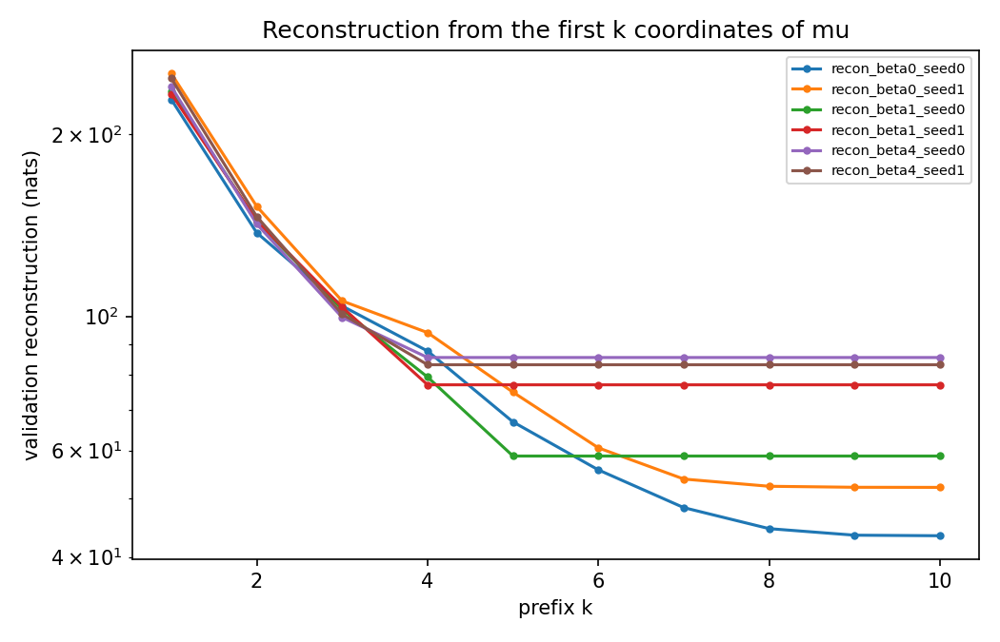
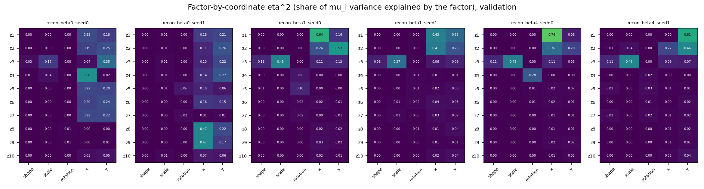
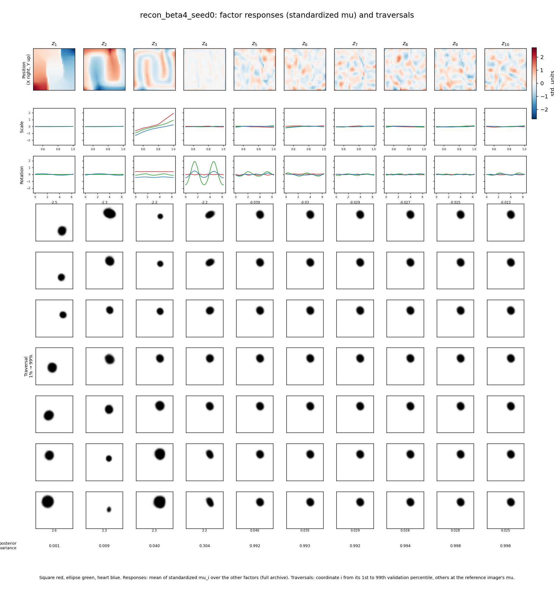
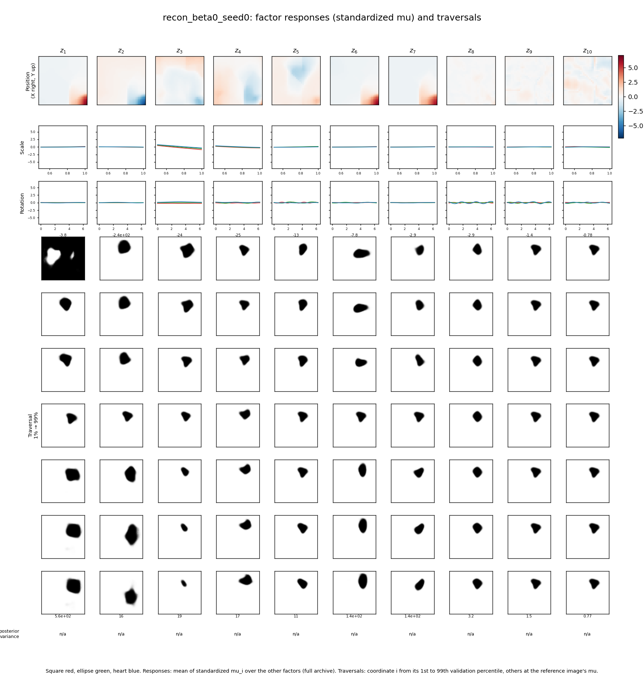
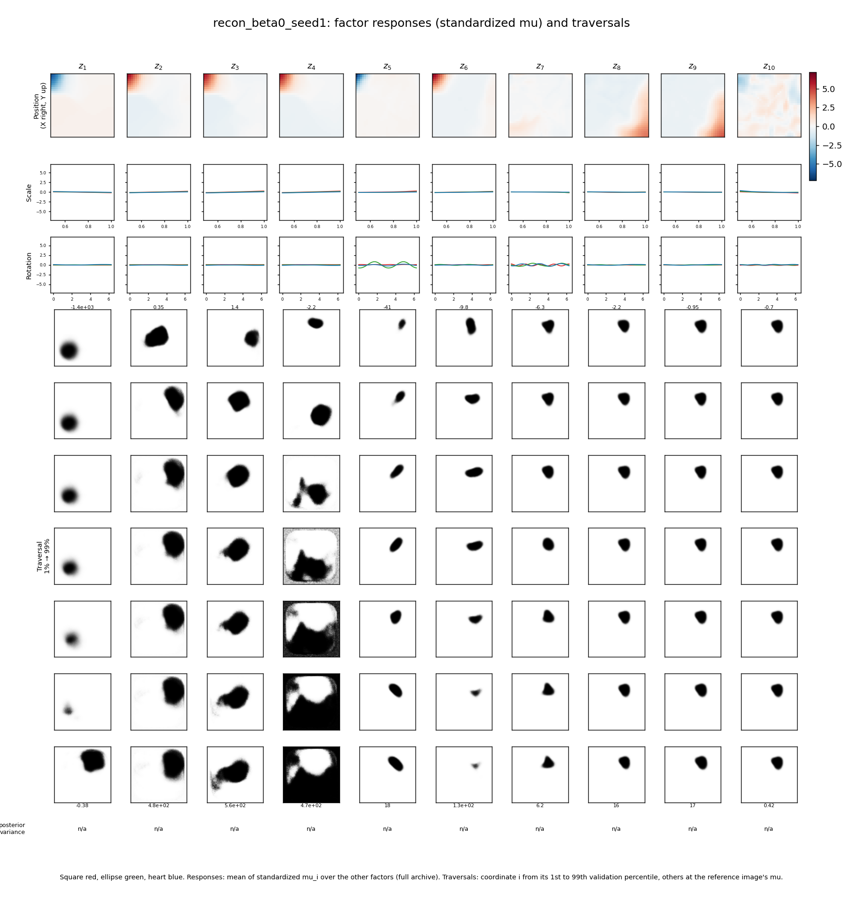
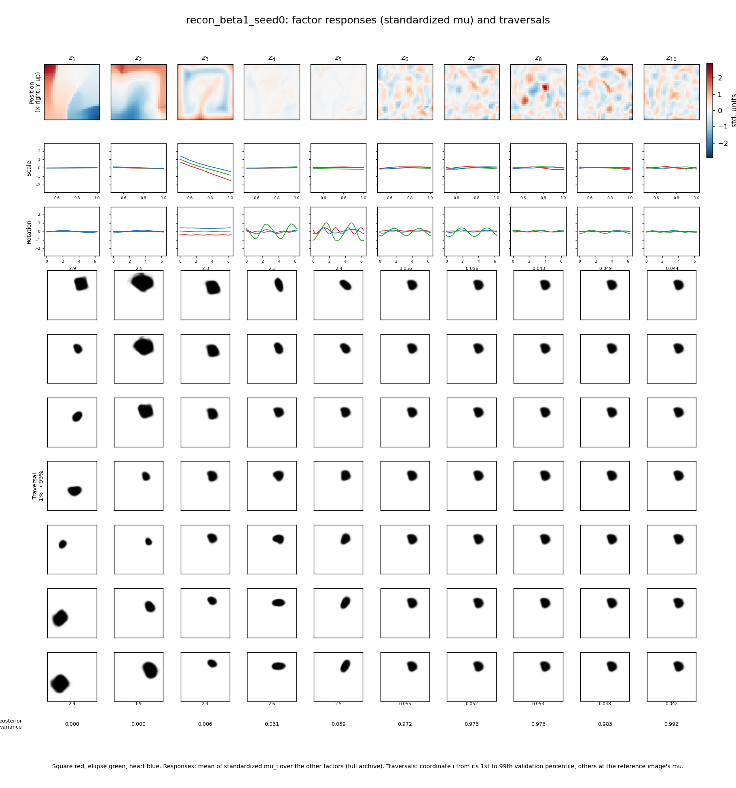
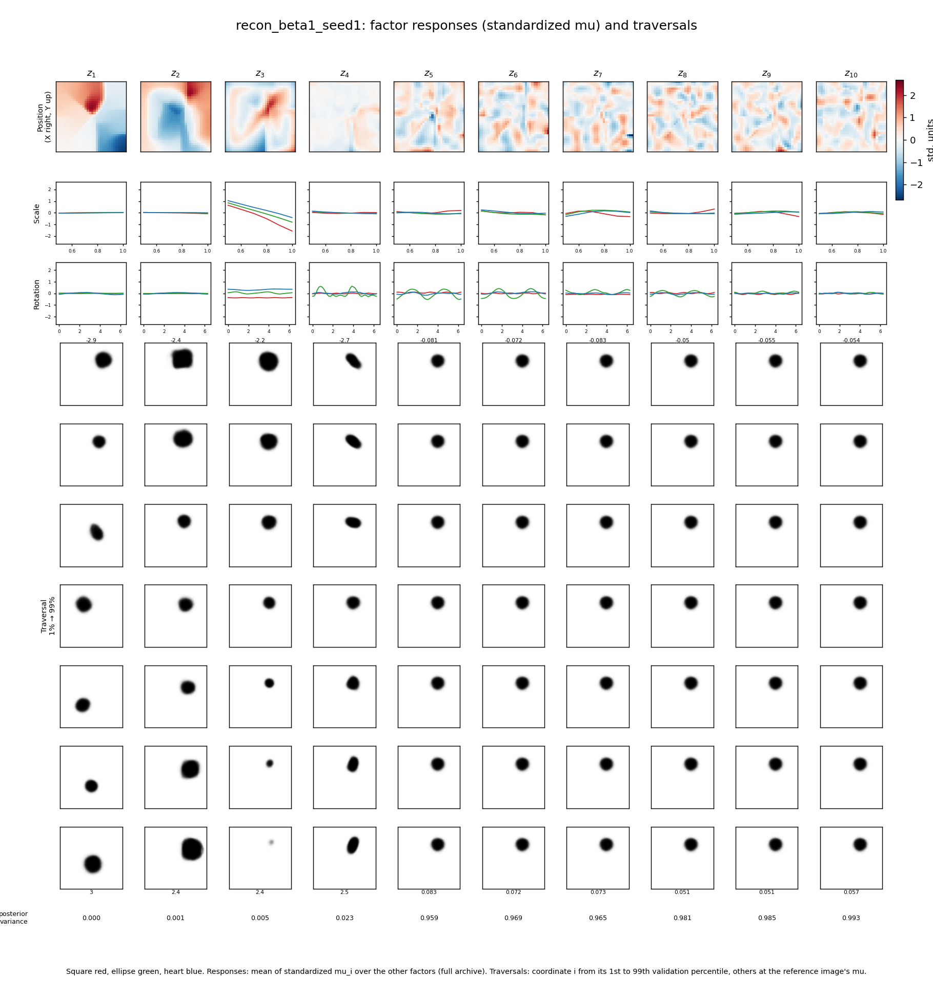
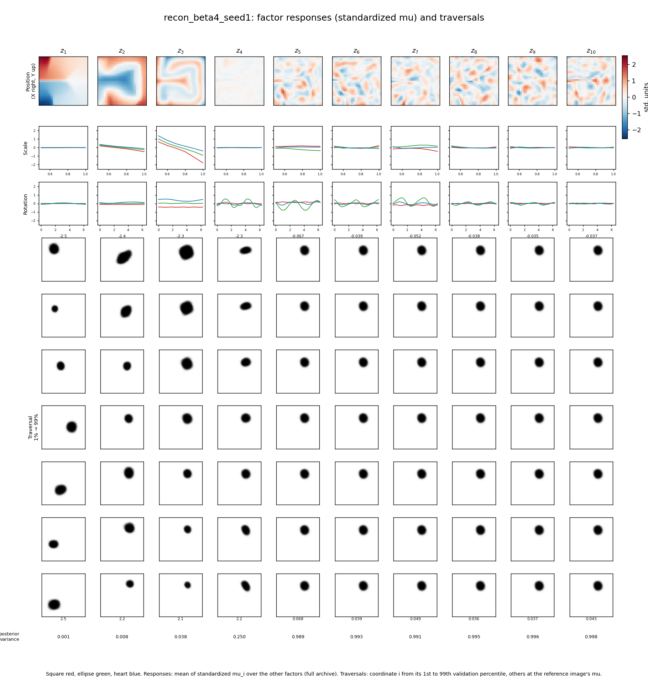
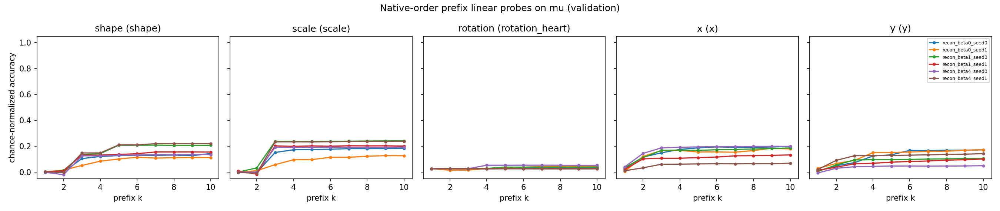

# Meeting report: MRL pretraining on dSprites, reconstruction-only encoders ($S_{\text{recon}}$)

**Prepared:** 2026-10-29.  
**Meeting date:** To be set.  
**Status:** All six reconstruction-only runs finished (100 epochs each) and analyzed. The supervised X-position runs ($S_{\text{posX}}$) have not started; only a short pilot to choose their loss weight is done. Future directions will be curated by Argha.

## Questions we are trying to answer

We want encoders whose first latent coordinates carry known information, so we can later measure how a task's important directions line up with those coordinates.

This report covers the first step: **what does Matryoshka (MRL) reconstruction alone put into each coordinate, and how does the KL weight $\beta$ change that?**

1. Does MRL put the useful information into the first few coordinates?
2. How many coordinates does each model actually use?
3. Which image factor (shape, scale, rotation, X, Y) does each coordinate carry?
4. Does this repeat across two training seeds?

The three models differ only in $\beta$:

| $\beta$ | Model | Latent $z$ |
|---|---|---|
| 0 | MRL autoencoder | $z=\mu(x)$, no sampling, no KL |
| 1 | MRL VAE | $z=\mu(x)+\sigma(x)\odot\epsilon$, KL weight 1 |
| 4 | MRL β-VAE | same, KL weight 4 |

No labels are used in training. Labels are used only to evaluate.

## Analysis we did

### Training and evaluation settings

| Setting | Value |
|---|---|
| Data | dSprites, 737,280 binary $64\times64$ images |
| Split | Random 80 / 10 / 10 (seed 0): 589,824 train, 73,728 validation, 73,728 test. Same split for every run. |
| Model | Same MLP as before: encoder $4096\to1200\to1200\to(\mu,\log\sigma^2)$, 10 latent coordinates; decoder $10\to1200\to1200\to1200\to4096$ (Tanh) |
| Loss | $\mathcal L=\frac1{10}\sum_{k=1}^{10}R_k+\beta\,\mathrm{KL}$, where $R_k$ is the reconstruction from the first $k$ coordinates (the rest set to 0). KL is computed once on all 10 coordinates. |
| $\beta$ | 0, 1, 4 |
| Seeds | 0, 1 |
| Training | 100 epochs, batch 256, Adagrad, learning rate 0.01 |
| Evaluation | Validation images, posterior mean $\mu(x)$ (never a random sample) |

**Difference from the 2026-10-14 runs:** those trained on all 737,280 images. These train on the 80% split, so the validation images are unseen. The numbers are close but not identical.

**Reconstruction loss** is in nats: for one image, $-\sum_{p=1}^{4096}\left[x_p\ln\hat p_p+(1-x_p)\ln(1-\hat p_p)\right]$, averaged over validation images. Lower is better, and 0 is a perfect copy.

### 1. Reconstruction from the first $k$ coordinates



<small>Figure: /home/argha/Mat_embedding/code/NonLinearPB/NonLinearPBMeetingNotes/assets/2026_10_29_recon_prefix_reconstruction.png</small>

| Run | $k=1$ | $k=2$ | $k=3$ | $k=4$ | $k=5$ | $k=10$ |
|---|---:|---:|---:|---:|---:|---:|
| $\beta=0$, seed 0 | 228.5 | 137.5 | 104.0 | 87.6 | 66.9 | **43.4** |
| $\beta=0$, seed 1 | 252.2 | 152.1 | 106.1 | 94.0 | 74.9 | **52.1** |
| $\beta=1$, seed 0 | 236.0 | 143.6 | 102.7 | 79.4 | 58.7 | **58.7** |
| $\beta=1$, seed 1 | 233.5 | 144.0 | 103.6 | 77.1 | 77.1 | **77.1** |
| $\beta=4$, seed 0 | 239.9 | 142.2 | 99.6 | 85.5 | 85.5 | **85.5** |
| $\beta=4$, seed 1 | 247.7 | 146.3 | 100.9 | 83.2 | 83.2 | **83.2** |

**What we see:**
- In every run, most of the gain comes from the first 3–4 coordinates. MRL puts the useful information first.
- With $\beta=1$ and $\beta=4$, the curve becomes **exactly flat** after 4–5 coordinates. The remaining coordinates add nothing.
- With $\beta=0$, the curve keeps going down until about $k=8$–$9$, and the final reconstruction is the best (43–52 nats). Without a KL term, the model uses almost all 10 coordinates.

### 2. How many coordinates are used

We counted "active" coordinates in three ways:

1. **Variance rule:** coordinate $i$ is active if $\mathrm{Var}(\mu_i)$ is more than 1% of the largest coordinate variance.
2. **KL rule** ($\beta>0$ only): active if its average KL is above 0.01 nats.
3. **Reconstruction-gain rule:** coordinate $k$ is active if adding it lowers reconstruction by more than 0.5 nats.

| Run | Variance rule | KL rule | Reconstruction-gain rule | KL per coordinate (nats) |
|---|---:|---:|---:|---|
| $\beta=0$, seed 0 | 4 | n/a | **9** | n/a |
| $\beta=0$, seed 1 | 4 | n/a | **8** | n/a |
| $\beta=1$, seed 0 | 5 | 5 | 5 | 5.39, 4.04, 2.64, 1.93, 1.53, 0, 0, 0, 0, 0 |
| $\beta=1$, seed 1 | 4 | 4 | 4 | 5.35, 3.86, 2.72, 2.07, 0, … |
| $\beta=4$, seed 0 | 4 | 4 | 4 | 4.37, 2.68, 1.74, 0.69, 0, … |
| $\beta=4$, seed 1 | 4 | 4 | 4 | 4.30, 2.65, 1.73, 0.83, 0, … |

**What we see:**
- With $\beta>0$, all three rules agree, and the active coordinates are always the **first** ones. KL goes down from $z_1$ to the last active coordinate and is 0 after that.
- With $\beta=0$, the variance rule is **wrong**: it says 4, but reconstruction shows 8–9 coordinates in use. Without KL, nothing fixes the size of each coordinate, so a used coordinate can have small variance. **At $\beta=0$, use the reconstruction-gain rule.**

### 3. Which factor each coordinate carries

For each coordinate $\mu_i$ and each factor, we computed $\eta^2$: the fraction of the variance of $\mu_i$ that is explained by that factor's value. It runs from 0 (no relation) to 1 (fully determined). It does not assume a straight-line relation.



<small>Figure: /home/argha/Mat_embedding/code/NonLinearPB/NonLinearPBMeetingNotes/assets/2026_10_29_recon_factor_coordinate_eta2.png</small>

| Run | $z_1$ | $z_2$ | $z_3$ | $z_4$ |
|---|---|---|---|---|
| $\beta=1$, seed 0 | X 0.64 | Y 0.53 | scale 0.45 | rotation 0.06 |
| $\beta=1$, seed 1 | X 0.43, Y 0.35 | X 0.41, Y 0.25 | scale 0.37 | — |
| $\beta=4$, seed 0 | X 0.74 | X 0.36, Y 0.20 | scale 0.43 | rotation 0.28 |
| $\beta=4$, seed 1 | Y 0.61 | Y 0.46, X 0.22 | scale 0.46 | — |
| $\beta=0$, seed 0 | X 0.23, Y 0.18 | Y 0.25 | Y 0.35 | X 0.50 |
| $\beta=0$, seed 1 | Y 0.21 | Y 0.26 | Y 0.22 | Y 0.27 |

**What we see:**
- **With $\beta>0$, the same order repeats in all four runs:** position in $z_1,z_2$, then **scale in $z_3$**, then rotation in $z_4$ when a fourth coordinate is kept.
- **Which position factor comes first changes with the seed.** In $\beta=4$, $z_1$ is mostly X in seed 0 but mostly Y in seed 1. In $\beta=1$ seed 1, both $z_1$ and $z_2$ mix X and Y. X and Y affect the image equally, so nothing in the loss prefers one over the other.
- **With $\beta=0$, there is no clear coordinate-to-factor match.** Position is spread over many coordinates, each with $\eta^2$ of only 0.2–0.5. Scale and rotation never get their own coordinate.
- **Shape is barely in any single coordinate** ($\eta^2\le0.11$, always in $z_3$ together with scale).

### 4. Figure 6 for each run

Each figure shows, for each coordinate $z_1,\dots,z_{10}$:
- **Top row:** the average of that coordinate at each (X, Y) position.
- **Next two rows:** the average as scale or rotation changes, with one line per shape (square red, ellipse green, heart blue).
- **Bottom rows:** a traversal, where one coordinate moves from its 1st to its 99th percentile and the others stay fixed at a reference image.

We standardized each coordinate first (mean 0, standard deviation 1), because at $\beta=0$ the raw sizes are arbitrary. Posterior variance is shown as n/a at $\beta=0$.



<small>Figure: /home/argha/Mat_embedding/code/NonLinearPB/NonLinearPBMeetingNotes/assets/2026_10_29_figure6_recon_beta4_seed0.png</small>

**$\beta=4$, seed 0:**
- $z_1$ moves the shape across the image.
- $z_2$ also moves it, along a **folded (S-shaped) path**.
- $z_3$ changes size, and its scale curve rises for all three shapes.
- $z_4$ changes rotation, mostly for the ellipse, whose curve repeats twice per full turn.
- $z_5$–$z_{10}$ do nothing (posterior variance about 1, the prior).

The position maps are folded, not smooth ramps. That is why straight-line probes do poorly on position (section 5).



<small>Figure: /home/argha/Mat_embedding/code/NonLinearPB/NonLinearPBMeetingNotes/assets/2026_10_29_figure6_recon_beta0_seed0.png</small>

**$\beta=0$, seed 0:**
- Several coordinates take very large values in one corner of the image (X high, Y low), and those values dominate the colour scale.
- Most traversals change position and size together.
- At extreme values the decoder produces broken images, for example $z_1$ at its 1st percentile.

The other four runs:






<small>Figures: /home/argha/Mat_embedding/code/NonLinearPB/NonLinearPBMeetingNotes/assets/2026_10_29_figure6_recon_beta0_seed1.png; /home/argha/Mat_embedding/code/NonLinearPB/NonLinearPBMeetingNotes/assets/2026_10_29_figure6_recon_beta1_seed0.png; /home/argha/Mat_embedding/code/NonLinearPB/NonLinearPBMeetingNotes/assets/2026_10_29_figure6_recon_beta1_seed1.png; /home/argha/Mat_embedding/code/NonLinearPB/NonLinearPBMeetingNotes/assets/2026_10_29_figure6_recon_beta4_seed1.png</small>

### 5. Prefix probes

For each factor and each $k=1,\dots,10$, we trained a straight-line (linear) classifier on the first $k$ coordinates, using 50,000 training images, and tested it on validation images. For X, Y and scale, we also fit a straight-line regression and report $R^2$.



<small>Figure: /home/argha/Mat_embedding/code/NonLinearPB/NonLinearPBMeetingNotes/assets/2026_10_29_recon_prefix_probes.png</small>

Results with all 10 coordinates ($k=10$):

| Run | Shape acc. (chance 33%) | Scale $R^2$ | Rotation acc., hearts (chance 2.6%) | X $R^2$ | Y $R^2$ |
|---|---:|---:|---:|---:|---:|
| $\beta=0$, seed 0 | 43% | 0.32 | 6% | 0.56 | 0.61 |
| $\beta=0$, seed 1 | 41% | 0.21 | 7% | 0.81 | 0.73 |
| $\beta=1$, seed 0 | 47% | 0.46 | 6% | 0.71 | 0.63 |
| $\beta=1$, seed 1 | 44% | 0.37 | 5% | 0.36 | 0.54 |
| $\beta=4$, seed 0 | 42% | 0.42 | 8% | 0.71 | 0.23 |
| $\beta=4$, seed 1 | 48% | 0.50 | 5% | 0.05 | 0.53 |

**What we see:**
- Straight-line probes give **low and uneven** numbers. For example, $\beta=4$ seed 1 has X $R^2=0.05$, yet it reconstructs the shape in the right place, so X must be encoded. Figure 6 shows why: position is stored along folded paths, which a straight line cannot read.
- **These probes underestimate what the coordinates contain.** Nonlinear (small MLP) probes are needed before drawing conclusions about how much information is present. The code for MLP probes already exists (`fit_mlp_probe`) but was not run here.
- Rotation is near chance in every model, even though Figure 6 shows a rotation coordinate at $\beta=4$. Rotation is circular, and squares and ellipses look the same after some rotations, so a straight-line classifier on 39 rotation classes is a hard test.

### 6. Supervised pilot (for the next runs)

To choose the weight $\lambda$ of the X-position loss for $S_{\text{posX}}$, we trained four short runs: $\beta=4$, seed 0, 10 epochs, $\lambda\in\{10,30,100,300\}$.

| $\lambda$ | Coordinate tracking X | Spearman $\rho(\mu_1,X)$ | Full-latent X head acc. | Active dims | Recon at $k=10$ |
|---|---|---:|---:|---:|---:|
| 10 | none | −0.07 | 7.3% | 3 | 103.7 |
| 30 | $z_2$ ($\rho=0.88$) | −0.12 | 16.1% | 4 | 103.7 |
| 100 | $z_1$ | −0.77 | 68.2% | 6 | 95.5 |
| 300 | $z_1$ | −0.75 | 85.9% | 8 | 97.1 |

From $\lambda=100$ to $300$, $z_1$ does not get better at tracking X, but more X information goes into later coordinates and more coordinates stay active. So larger $\lambda$ spreads X over more coordinates. We chose $\lambda=100$ (confirmed 2026-10-29): it is the smallest value that puts X in $z_1$. The pilot and the choice are recorded in `/home/argha/Mat_embedding/files/results/exprmnt_2026_10_29__12_03_09/lambda_sup.json`.

### Limitations

- Only two seeds per $\beta$.
- Probes are linear only. MLP probes are pending.
- $\eta^2$ looks at one coordinate and one factor at a time. It does not show information that is spread across several coordinates.
- At $\beta=0$, coordinate sizes are arbitrary. Figures use standardized values, and the variance-based active count is unreliable there.
- The pilot is 10 epochs and one seed.

## Summary

- **MRL works as an ordering pressure.** In all six runs, most of the reconstruction comes from the first 3–4 coordinates.
- **The KL term decides how many coordinates are kept.** $\beta=1$ keeps 4–5 and $\beta=4$ keeps 4, always the leading ones. $\beta=0$ uses 8–9 and reconstructs best.
- **With $\beta>0$, coordinate roles repeat across seeds:** position in $z_1,z_2$, scale in $z_3$, rotation in $z_4$ when kept. But whether $z_1$ is X or Y changes with the seed, and the two are often mixed. MRL alone does not separate X from Y.
- **With $\beta=0$, there is no clean factor-to-coordinate structure.** Position is spread over many coordinates.
- **Straight-line probes are not enough** for these models, because position is stored in folded, nonlinear maps.

Unresolved: how much each prefix really contains (needs MLP probes), and whether supervision ($S_{\text{posX}}$) pins X to $z_1$ reliably.

## Future directions

**To be curated by Argha after reviewing the results and discussing them with the professors.**

No new experiment or method choice is committed by this section.

## Technical details

### Experiment identity and folders

- Experiment: P1, MRL source-encoder pretraining (reconstruction-only stage plus $\lambda$ pilot).
- Parent experiment folder: `/home/argha/Mat_embedding/files/results/exprmnt_2026_10_29__12_03_09/`. Every job is a subfolder of this parent, named `<objective>_beta<β>_seed<seed>[_lam<λ>]`.
- Plan: `/home/argha/Mat_embedding/code/NonLinearPB/plans/PrivilagedBasisRotation.md` (pretraining specification).

| Job | Full path | Training runtime |
|---|---|---|
| `recon_beta0_seed0` | `/home/argha/Mat_embedding/files/results/exprmnt_2026_10_29__12_03_09/recon_beta0_seed0/` | 1 h 59 min |
| `recon_beta0_seed1` | `/home/argha/Mat_embedding/files/results/exprmnt_2026_10_29__12_03_09/recon_beta0_seed1/` | 1 h 59 min |
| `recon_beta1_seed0` | `/home/argha/Mat_embedding/files/results/exprmnt_2026_10_29__12_03_09/recon_beta1_seed0/` | 1 h 49 min |
| `recon_beta1_seed1` | `/home/argha/Mat_embedding/files/results/exprmnt_2026_10_29__12_03_09/recon_beta1_seed1/` | 2 h 22 min |
| `recon_beta4_seed0` | `/home/argha/Mat_embedding/files/results/exprmnt_2026_10_29__12_03_09/recon_beta4_seed0/` | 2 h 22 min |
| `recon_beta4_seed1` | `/home/argha/Mat_embedding/files/results/exprmnt_2026_10_29__12_03_09/recon_beta4_seed1/` | 2 h 22 min |
| `posx_beta4_seed0_lam10_ep10` (pilot, 10 epochs) | `/home/argha/Mat_embedding/files/results/exprmnt_2026_10_29__12_03_09/posx_beta4_seed0_lam10_ep10/` | — |
| `posx_beta4_seed0_lam30_ep10` (pilot) | `/home/argha/Mat_embedding/files/results/exprmnt_2026_10_29__12_03_09/posx_beta4_seed0_lam30_ep10/` | — |
| `posx_beta4_seed0_lam100_ep10` (pilot) | `/home/argha/Mat_embedding/files/results/exprmnt_2026_10_29__12_03_09/posx_beta4_seed0_lam100_ep10/` | — |
| `posx_beta4_seed0_lam300_ep10` (pilot) | `/home/argha/Mat_embedding/files/results/exprmnt_2026_10_29__12_03_09/posx_beta4_seed0_lam300_ep10/` | — |

Each job folder contains `checkpoint_final.pt` (and every 10 epochs), `training.jsonl` (per-epoch losses; validation every 10 epochs), `training_curves_<stamp>.png`, `results_summary.txt`, `final_validation.json`, `config.json`, `environment.json`, `split_manifest.npz`, `status.json` and `runtime.txt`.

Runtimes are longer than one job alone would take, because three jobs shared each GPU. Speed was about 70 s/epoch per job with 3 jobs per GPU; one job alone runs at about 22 s/epoch.

**Analysis folders** (analysis was run after training for these six runs, before the per-job automatic analysis was added):

- Seed-0 runs: `/home/argha/Mat_embedding/files/results/exprmnt_2026_10_29__12_03_09/analysis_2026_10_29__14_51_35/`
- Seed-1 runs: `/home/argha/Mat_embedding/files/results/exprmnt_2026_10_29__12_03_09/analysis_2026_10_29__14_51_37/`
- Combined plots and numbers, all six runs: `/home/argha/Mat_embedding/files/results/exprmnt_2026_10_29__12_03_09/analysis_combined_2026_10_29__14_56_15/` (`analysis.json`, `results_summary.txt`)

A duplicate queue was accidentally started at 12:01 and stopped after a few minutes. Its partial output is `/home/argha/Mat_embedding/files/results/exprmnt_2026_10_29__12_01_04/`; it is not used in this report.

### Environment, hardware, and execution

| Item | Value |
|---|---|
| Conda environment | `mrl_env_cuda12` |
| PyTorch | 2.5.1+cu124 |
| NumPy / SciPy / Matplotlib | 2.2.6 / 1.15.3 / 3.10.8 |
| CUDA build | 12.4 |
| Hardware | Two NVIDIA RTX 3090 GPUs; 3 jobs per GPU |
| Precision | Float32; TF32 disabled |
| Git commit at launch | `5bb27f49cf8723fbb99cff34f2ed1094e9f4531a` (new pretraining code not yet committed) |
| tmux sessions | `dsprites-pretrain-2026_10_29__12_03_08` (training), `dsprites-pretrain-analysis` (analysis) |

Queue log: `/home/argha/Mat_embedding/files/results/launch_logs/dsprites-pretrain-2026_10_29__12_03_08/workflow.log`. Per-job console logs: `/home/argha/Mat_embedding/files/results/exprmnt_2026_10_29__12_03_09/logs/`.

### Data, architecture, and objectives

```text
Archive: /home/argha/Mat_embedding/data/dsprites/dsprites_ndarray_co1sh3sc6or40x32y32_64x64.npz
SHA-256: 857dc001287e8efa226e0025fac6b29e5745c621b380b0d3363e4e33f4e28fa2
Split:   seed 0, 589,824 / 73,728 / 73,728, saved in each job's split_manifest.npz
Encoder: 4096 → FC1200/ReLU → FC1200/ReLU → mean10 / logvar10
Decoder: 10 → FC1200/Tanh → FC1200/Tanh → FC1200/Tanh → FC4096 logits
```

Prefix masking keeps the first $k$ coordinates and sets the rest to 0:

$$
\tilde z^{(k)}=(z_1,\ldots,z_k,0,\ldots,0),\qquad
\mathcal L=\frac1{10}\sum_{k=1}^{10}R_k+\beta K.
$$

All ten prefixes go through the shared decoder as one batch. For $\beta>0$, $z$ is one sample per image, shared by all prefixes; for $\beta=0$, $z=\mu(x)$ and the KL term is not used. The supervised pilot adds $\lambda\cdot\frac{1}{\ln 32}\cdot\frac1{10}\sum_k\mathrm{CE}(\text{head}_k(z_{1:k}),X)$ with one linear head $\mathbb R^k\to\mathbb R^{32}$ per prefix.

### Code and saved analysis

- Training (one job): `/home/argha/Mat_embedding/code/NonLinearPB/NonLinearPBExperiments/experiments/dsprites_pretrain.py`
- Loss and heads (`mrl_pretrain_loss`, `PrefixHeads`): `/home/argha/Mat_embedding/code/NonLinearPB/NonLinearPBExperiments/vae_reproduction/model.py`
- GPU queue: `/home/argha/Mat_embedding/code/NonLinearPB/NonLinearPBExperiments/scripts/run_dsprites_pretrain.py`; tmux launcher: `/home/argha/Mat_embedding/code/NonLinearPB/NonLinearPBExperiments/scripts/run_dsprites_pretrain_tmux.sh`
- Analysis: `/home/argha/Mat_embedding/code/NonLinearPB/NonLinearPBExperiments/scripts/analyze_pretrain.py`. From now on, every training job runs this analysis itself as soon as it finishes; it can also be re-run standalone, and `--combine-only` makes combined plots.
- Tests (to be run by Argha): `/home/argha/Mat_embedding/code/NonLinearPB/NonLinearPBExperiments/tests/helper_pretrain.py`
- Report figures were copied to `/home/argha/Mat_embedding/code/NonLinearPB/NonLinearPBMeetingNotes/assets/` with the prefix `2026_10_29_`.
