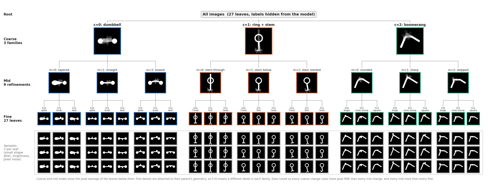
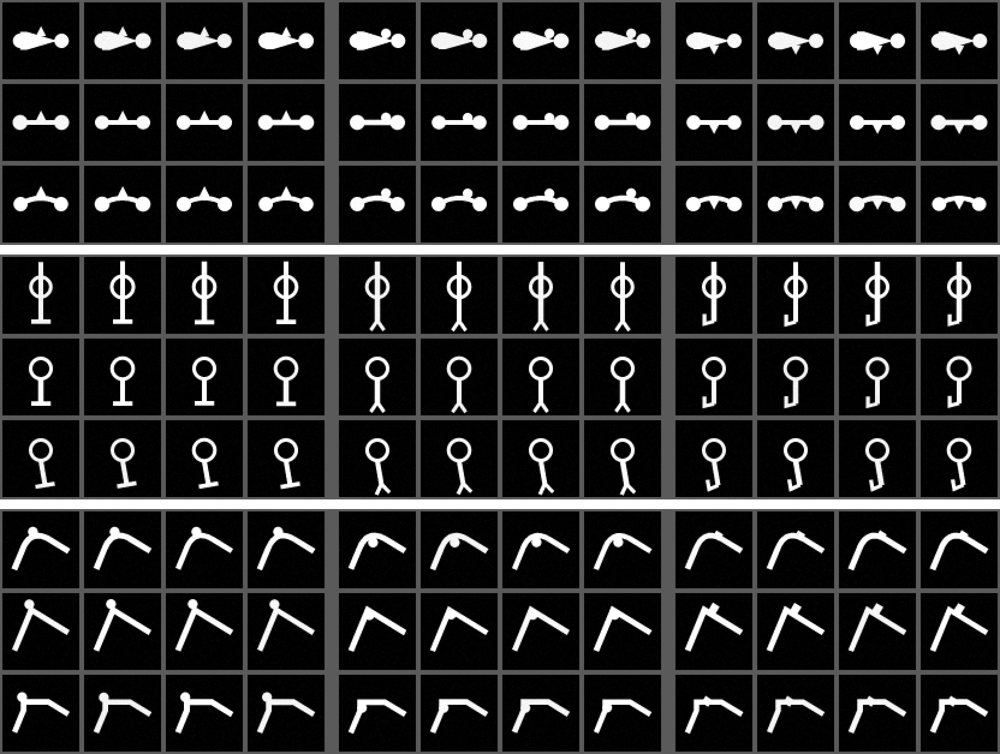

# Report: Hierarchical synthetic image dataset, v1 (Experiment 1 data)

> **Superseded by v2** (same day): see `2026_11_02_hierarchical_dataset_v2_report.md`. The leakage probe showed that dumbbell tapered/straight and ring through/below share identical fine details (transfer 1.00), and single fine pairs overlapped noise because of ±0.3 px jitter. Use `hierarchical_images_v2` for Experiment 1. This report stays as the record of the design, cost method and v1 tuning.

**Prepared:** 2026-11-02.  
**Status:** v1 generated and frozen at `/home/argha/Mat_embedding/data/synthetic_data/hierarchical_images_v1/`. No autoencoder has been trained on it yet.  
**Spec:** `NonLinearPB/plans/hierarchical_synthetic_data_spec.md` (updated 2026-11-02 with the v1 decisions below).

## Why this dataset

Experiment 1 asks whether a nonlinear Matryoshka autoencoder (MRL-AE) learns **coarse-to-fine groupings**: do short prefixes of the latent code separate the big groups, and do longer prefixes split those groups further rather than redraw them?

To test that, we need images whose hierarchy we know exactly and whose levels have a known **reconstruction-cost order**:

$$\Delta_{\text{coarse}} > \Delta_{\text{mid}} > \Delta_{\text{fine}} > \Delta_{\text{noise}}$$

- **Coarse:** changing the overall shape costs the most.
- **Mid:** changing a major part costs less.
- **Fine:** changing a small detail costs even less.
- **Noise:** random within-group variation costs the least.

The labels are kept for evaluation only. The autoencoder is trained on images alone.

## The tree

3 coarse families × 3 mid refinements × 3 fine details = **27 leaves**. Each leaf is a small distribution of images, not one fixed template.



<small>Figure: /home/argha/Mat_embedding/code/NonLinearPB/NonLinearPBMeetingNotes/assets/2026_11_02_hier_v1_tree.png. Coarse and mid nodes show the pixel average of the leaves below them: bright parts are shared by all children, faint parts are where children differ. Bottom block: 3 random samples per leaf.</small>

| Coarse `c` | Body | Mid `m` (0 / 1 / 2) | Fine `f` (0 / 1 / 2) | Where the fine detail sits |
|---|---|---|---|---|
| 0 | dumbbell: two round lobes joined by a horizontal connector | tapered / straight / bowed connector | spike / knob / keel | on the connector, at its midpoint (bowed: the apex); spike on top, knob on top beside it, keel underneath |
| 1 | ring + stem: a ring with a vertical stem | stem through the ring and sticking out above / stem below the ring / stem slanted | T-foot / fork / hook | at the free (bottom) end of the stem |
| 2 | boomerang: a diagonal arm bent once | rounded / sharp / stepped bend | bulge / inner bump / square | at the bend: outside, inside, and on the outer edge of the right arm beside the bend |

**Nesting rule (spec section 2).** Mid parts are drawn from the coarse family's own geometry, and fine details are anchored to the `(c, m)` geometry. So `f=0` means a different detail in each family, and within a family it moves with its parent (for example, the dumbbell spike sits on the bowed connector's apex when `m=2`).

## Decisions made before generating (2026-11-02)

| Decision | Reason |
|---|---|
| **No whole-object translation.** Images stay centred. | Moving a large shape by 1 px changes its whole outline, which can cost more than a fine detail. Shifts also blur group averages, which hides fine details. Small shifts are left for a later experiment. |
| **Within-leaf variation = small shape jitter + brightness + pixel noise.** | Brightness and noise alone would make each leaf almost one image (27 memorisable templates). Jitter changes part sizes (lobe/ring radius, stroke width, arm/connector length) without changing any label or moving the whole object. |
| **Jitter cost must be measured, not assumed.** | A 0.5 px radius change on a radius-10 circle already costs about as much as a fine detail. So jitter is sub-pixel (±0.3 px), which needs drawing at 4× resolution. |
| **Pixel MSE for both data checks and AE training.** | If we tune the cost order with MSE but train with BCE, the model may rank changes differently. |
| **Separate seeds per split; test never used for tuning.** | Keeps the test set independent. Tuning used a separate calibration stream. |
| **Costs are nested, and we say so.** | Changing the family also changes its connector and detail, because they are built on it. That is what a nested hierarchy means. |
| **Location:** `data/synthetic_data/hierarchical_images_v1/`; trial runs in `files/results/hier_synthetic_pilot/`. | Only the frozen version goes in `data/`. Any later generator change becomes `v2`. |

## How the images are made

Code: `NonLinearPB/NonLinearPBExperiments/hier_synthetic/render.py`.

1. Draw on a 256 × 256 canvas (4× supersampling) with Pillow. All geometry is in 64-pixel units.
2. Draw the coarse body, then the mid part built on it. The mid function returns an **anchor**: a point, an outward direction and the local stroke width.
3. Draw the fine detail at that anchor.
4. Downsample to 64 × 64 with box averaging (anti-aliasing), giving values in [0, 1].
5. Multiply by a brightness gain, add Gaussian pixel noise, clip to [0, 1].
6. Store as uint8 (`round(255 · x)`). Load as `images / 255`.

### Within-leaf variation (nuisance)

Every image draws its own nuisance from its own recorded seed (`nuisance_seed`):

| Component | Setting |
|---|---|
| Shape jitter | radius, stroke width and length each uniform in ±0.3 px (applied to whichever part each family has: lobe/ring radius, connector/stem/arm width, connector/stem/arm length) |
| Brightness | gain uniform in [0.95, 1.05] |
| Pixel noise | Gaussian, σ = 0.01 |
| Translation | none |

### Frozen shape settings (`GEOM` in `render.py`, 64-pixel units)

| Family | Settings |
|---|---|
| c=0 dumbbell | lobe radius 6.0; lobe centres at 32 ± 17; connector width 4.0; taper 3.6w → 0.3w; bow height 5.0; spike half-base 4.0, height 8.0; knob radius 4.0, shifted 7.0 along the connector; keel half-base 4.0, height 7.5 |
| c=1 ring + stem | ring centre (32, 25), radius 10.0, thickness 3.0; stem width 4.0, bottom at y = 54; "through" stem sticks out 11.0 above the ring; slant 3.5 px at the foot; T-foot half-width 8.0, thickness 3.5; fork prongs length 7.0, spread 5.5, thickness 3.0; hook side 8.0, up 6.0, thickness 3.0 |
| c=2 boomerang | arm ends (10, 48) and (55, 33), bend at (24, 14); width 4.5; rounding uses 50% of each arm; step uses 46%; bulge and inner bump radius 4.0; square side 6.5, shifted 9.0 along the right arm |

## How the costs were measured

Code: `cost_ladder()` and `conditional_variance()` in `NonLinearPB/NonLinearPBExperiments/scripts/generate_hier_dataset.py`.

### Cost of one pair

$$D(x, x') = \frac{1}{4096}\sum_{p=1}^{4096} (x_p - x'_p)^2, \qquad x \in [0,1]^{64\times 64}$$

Images are uint8-quantised first, exactly as stored. For intuition, $4096 \cdot D$ is the number of pixels that would have to flip fully from black to white: a fine change ≈ 60 pixels, a coarse change ≈ 500 pixels.

### Matched pairs

Both images in a pair share the **same nuisance seed** (same jitter, brightness and noise). Only one label differs.

| Level | Pair | Fixed | Pairs |
|---|---|---|---|
| Coarse | `(c, m, f)` vs `(c', m, f)` | m, f, seed | 3 family pairs × 9 `(m, f)` × 100 seeds = 2,700 |
| Mid | `(c, m, f)` vs `(c, m', f)` | c, f, seed | 3 sibling pairs × 9 `(c, f)` × 100 = 2,700 |
| Fine | `(c, m, f)` vs `(c, m, f')` | c, m, seed | 3 sibling pairs × 9 `(c, m)` × 100 = 2,700 |
| Noise | same leaf, seed r vs seed r+1 | c, m, f | 27 leaves × 100 = 2,700 |

The 100 nuisance seeds come from a **separate calibration stream** (seed 4004), not from train, val or test. $\Delta_{\text{level}}$ is the mean over that level's 2,700 pairs. Ratios are $\Delta_{\text{level}} / \Delta_{\text{fine}}$.

### Conditional-variance check

Pairwise cost measures how different siblings are, not exactly what an autoencoder loses when a level is missing. So we also predict every **training** image by the average image of its group and measure the error:

$$\text{MSE}_{\text{level}} = \frac{1}{N \cdot 4096}\sum_i \lVert x_i - \bar x_{g(i)} \rVert^2$$

with groups = all images (root), same coarse, same `(c, m)`, same leaf. The drop at each step is the error saved by knowing that label. We want: coarse gain > mid gain > fine gain > leftover (leaf-level) error.

## Tuning history

The first renderer was a draft with hand-picked sizes. Tuning used only the calibration stream and the training images, never test.

| Run | Calibration seeds | Coarse | Mid | Fine | Noise | Problem |
|---|---:|---:|---:|---:|---:|---|
| Trial 1 (draft renderer), `data_2026_11_02__10_37_58` | 100 | 21.0 | 4.98 | 1 | **0.27** | Coarse far too large; noise above 0.25; dumbbell tapered vs straight (0.0061) **cheaper than a fine change**; offset stem / bowed connector very expensive |
| Round 1: thinner bodies, bigger fine details, new detail shapes, `GEOM` table | 15 | 8.78 | 2.43 | 1 | 0.15 | Dumbbell spike vs knob and boomerang bulge vs square overlapped (0.27–0.30× fine); tapered vs straight still below fine |
| Round 2: details moved apart, stronger taper, flatter bow, thinner boomerang | 15 | 7.18 | 1.89 | 1 | 0.12 | Fine now too large; two mid pairs at the top of the fine range |
| Round 3: dumbbell and boomerang details ~10% smaller | 30 | 8.32 | 2.20 | 1 | 0.13 | Boomerang rounded vs stepped (0.0176) only just above the largest fine pair (0.0170) |
| Round 4 = **final**: stronger taper (3.6), bow 5.0, step 0.46 | 100 | **8.35** | **2.39** | 1 | **0.14** | Every pair in order; coarse still above the ~4 target (accepted) |

Changes from the draft that also renamed details: dumbbell notch → **keel**; ring "stem offset" → **stem slanted**; boomerang cutout → **inner bump**. Cut-outs were replaced because a cut into a thin stroke removes too few pixels to make a usable fine change.

## Results for the frozen v1

### Cost ladder

| Level | $\Delta$ (mean pixel MSE) | 95% CI | Ratio to fine | Range of single pairs |
|---|---:|---:|---:|---|
| Coarse | 0.1214 | ± 0.0006 | **8.35** | 0.074 – 0.159 |
| Mid | 0.0347 | ± 0.0004 | **2.39** | 0.016 – 0.057 |
| Fine | 0.0145 | ± 0.0001 | **1.00** | 0.005 – 0.020 |
| Noise | 0.0020 | ± 0.0001 | **0.14** | 0.00007 – 0.011 |

Target from the spec: about 4 : 2 : 1, noise < 0.25 × fine. **The order holds and noise is under the limit. Coarse is about 3.5× mid instead of 2×.**

### Per sibling pair (mean over 300 matched pairs each)

| Coarse pair | Cost | × fine |
|---|---:|---:|
| dumbbell vs ring + stem | 0.1314 | 9.04 |
| dumbbell vs boomerang | 0.1086 | 7.47 |
| ring + stem vs boomerang | 0.1241 | 8.54 |

| Family | Mid pair | Cost | × fine |
|---|---|---:|---:|
| dumbbell | tapered vs straight | 0.0264 | 1.82 |
| dumbbell | tapered vs bowed | 0.0472 | 3.25 |
| dumbbell | straight vs bowed | 0.0409 | 2.82 |
| ring + stem | through vs below | 0.0237 | 1.63 |
| ring + stem | through vs slanted | 0.0490 | 3.37 |
| ring + stem | below vs slanted | 0.0252 | 1.74 |
| boomerang | rounded vs sharp | 0.0296 | 2.04 |
| boomerang | rounded vs stepped | 0.0250 | 1.72 |
| boomerang | sharp vs stepped | 0.0449 | 3.09 |

| Family | Fine pair | Cost | × fine |
|---|---|---:|---:|
| dumbbell | spike vs knob | 0.0166 | 1.15 |
| dumbbell | spike vs keel | 0.0132 | 0.91 |
| dumbbell | knob vs keel | 0.0168 | 1.15 |
| ring + stem | T-foot vs fork | 0.0161 | 1.11 |
| ring + stem | T-foot vs hook | 0.0116 | 0.80 |
| ring + stem | fork vs hook | 0.0170 | 1.17 |
| boomerang | bulge vs inner bump | 0.0151 | 1.04 |
| boomerang | bulge vs square | 0.0140 | 0.96 |
| boomerang | inner bump vs square | 0.0105 | 0.73 |

| Family | Noise (same leaf, two seeds) | × fine |
|---|---:|---:|
| dumbbell | 0.0021 | 0.14 |
| ring + stem | 0.0028 | 0.20 |
| boomerang | 0.0010 | 0.07 |

**Every coarse pair (min 0.109) > every mid pair (max 0.049); every mid pair (min 0.024) > every fine pair (max 0.017); every fine pair (min 0.011) > every family's noise (max 0.003).** Full per-branch numbers (mean, variance, 95% CI, min, max) are in `cost_validation.csv`.

### Conditional-variance check (training images)

| Known up to | Groups | MSE of predicting by group mean | Error saved by this level |
|---|---:|---:|---:|
| nothing (root) | 1 | 0.0453 | — |
| coarse | 3 | 0.0147 | **0.0306** |
| mid | 9 | 0.0057 | **0.0091** |
| leaf (fine) | 27 | 0.0009 | **0.0048** |

0.0306 > 0.0091 > 0.0048 > 0.0009 left over. **Same order as the cost ladder.** (In `conditional_variance.csv`.)

### Integrity checks

| Check | Result |
|---|---|
| Split sizes | 43,200 train / 5,400 val / 5,400 test |
| Per leaf | exactly 1,600 / 200 / 200 for all 27 leaves |
| Nuisance seeds reused across splits | none |
| Duplicate images within a split | 0 / 0 / 0 |
| Images shared between splits | 0 (train–val, train–test, val–test) |
| Within-leaf diversity | every image unique; smallest same-leaf pair cost 0.00007 (> 0), mean 0.002 |
| Reproducibility | frozen `train.npz` is byte-identical to the last trial run's `train.npz` |

### Contact sheet (training images)



<small>Figure: /home/argha/Mat_embedding/code/NonLinearPB/NonLinearPBMeetingNotes/assets/2026_11_02_hier_v1_contact_sheet.png. Rows: the 9 `(c, m)` parents (3 dumbbell, 3 ring + stem, 3 boomerang). Columns: the 3 fine leaves × 4 training samples each.</small>

## Caveats and open items

1. **Coarse is larger than the target** (8.4 vs ~4 × fine, so ~3.5× mid instead of 2×). Swapping families repaints most of the shape. Pushing it lower would mean shrinking the bodies until the small details dominate. The spec calls the ratio a starting target, so we accepted it.
2. **Costs are nested.** A coarse pair also changes the mid part and the detail; a mid pair also changes the detail. The ladder is not a set of independent per-level costs.
3. **Single pairs overlap across levels even though sibling-pair means do not.** The cheapest single mid pair (0.016) is below the most expensive single fine pair (0.020), because of jitter. The ordering claim is about averages per sibling pair.
4. **Ring + stem: "through" and "below" share the same stem foot.** Both stems end at the same point, so the T-foot / fork / hook are drawn in the same place for those two parents (their fine costs are identical in `cost_validation.csv`). Only "slanted" moves the foot. The detail is still anchored to its parent's geometry, but for these two parents it is not visually different.
5. **Some fine features may be readable across families.** The spec's leakage probe (section 5, item 6: can a simple classifier predict `f` across unrelated parents?) **has not been run yet.**
6. **The test set was not drawn fresh after freezing.** The spec asks for a new test set after the generator is frozen. Here the test seed (3003) is the same one used in the two trial runs, so identical `test.npz` copies exist in the trial folders. Tuning only looked at the calibration stream and training images, never at test. If we want to follow the spec strictly, change the test seed and generate `v2`.
7. **Noise level differs by family:** the boomerang's noise is about a third of the ring + stem's (0.07 vs 0.20 × fine), because jitter of a thin ring and long stem changes more outline.
8. **Training must use pixel MSE.** The ladder was calibrated in MSE; if any run uses BCE, recalibrate with BCE first (spec section 8).

## Files

### Dataset (outside git)

`/home/argha/Mat_embedding/data/synthetic_data/hierarchical_images_v1/`

| File | Contents |
|---|---|
| `train.npz`, `val.npz`, `test.npz` | keys `images` (N × 64 × 64 uint8), `coarse`, `mid`, `fine`, `leaf_id` (= 9c + 3m + f), `nuisance_seed`; ordered by leaf, then index |
| `metadata.csv` | `sample_id, split, coarse, mid, fine, leaf_id, nuisance_seed` for all 54,000 images |
| `cost_validation.csv` | cost per level and per parent branch: n, mean, var, ci95, min, max |
| `conditional_variance.csv` | MSE by group mean at root / coarse / mid / leaf, and the reductions |
| `contact_sheet.png` | 9 parents × (3 leaves × 4 samples) |
| `config.json` | version `v1`, `frozen: true`, sizes, seeds, nuisance settings, cost ladder, integrity checks, SHA-256 of the npz files |
| `README.md` | regeneration command |

SHA-256:

```text
72a22a829b9731be2b36dd0e1dca57edcf6d7a78d857c30da01e109a28139596  train.npz
534dda4a847fb2be2a20572d889fd460f4bcd02349c9cdd86aca60c4398def6f  val.npz
111acce6ac2d4515b9c76b36ac8c0daf19eba7a2d6529f51f7b4f65747e070a7  test.npz
```

Seeds: train 1001, val 2002, test 3003, calibration 4004 (100 replicates). Generation took 57 s on CPU.

Loading:

```python
import numpy as np
d = np.load("/home/argha/Mat_embedding/data/synthetic_data/hierarchical_images_v1/train.npz")
x = d["images"].astype(np.float32) / 255.0      # (43200, 64, 64)
c, m, f, leaf = d["coarse"], d["mid"], d["fine"], d["leaf_id"]
```

### Code (in git, not yet committed)

| File | Role |
|---|---|
| `NonLinearPB/NonLinearPBExperiments/hier_synthetic/render.py` | renderer; `GEOM` holds every tuned size; `render(c, m, f, nuisance)`, `sample_nuisance(rng)` |
| `NonLinearPB/NonLinearPBExperiments/scripts/generate_hier_dataset.py` | makes splits, metadata, cost ladder, conditional variance, contact sheet, config, README; `--final` writes v1 and refuses to overwrite |
| `NonLinearPB/NonLinearPBExperiments/scripts/run_hier_dataset_tmux.sh` | launches the generator in tmux, log in `files/results/launch_logs/hier-dataset-<stamp>/` |
| `NonLinearPB/NonLinearPBExperiments/scripts/plot_hier_tree.py` | the tree figure above |

### Trial runs (kept)

`/home/argha/Mat_embedding/files/results/hier_synthetic_pilot/`:
- `data_2026_11_02__10_37_58/`: trial 1, draft renderer (fails the cost check).
- `data_2026_11_02__10_44_09/`: tuned renderer, identical images to v1.
- `tree_2026_11_02__10_32_34/`, `tree_2026_11_02__10_44_07/`: tree figures for the draft and final renderer.

### Reproduce

From `/home/argha/Mat_embedding/code`:

```bash
# frozen v1 (refuses if the folder exists)
bash NonLinearPB/NonLinearPBExperiments/scripts/run_hier_dataset_tmux.sh --final
# trial run into files/results/hier_synthetic_pilot/data_<stamp>/
bash NonLinearPB/NonLinearPBExperiments/scripts/run_hier_dataset_tmux.sh
# tree figure
python NonLinearPB/NonLinearPBExperiments/scripts/plot_hier_tree.py
```

Environment: `mrl_env_cuda12` (Python 3.10, NumPy 2.2.6, Pillow 12.1.1, Matplotlib 3.10.8).

## Next steps

1. Run the leakage probe (caveat 5).
2. Decide whether to give the ring + stem "through" and "below" parents different foot positions (caveat 4); that would be `v2`.
3. Train the standard AE and the full-prefix MRL-AE with the same architecture, same data, same 10-dimensional latent, pixel MSE loss, images only.
4. Compare prefix groupings against the 3 → 9 → 27 tree, and check across seeds whether longer prefixes refine earlier groupings.
