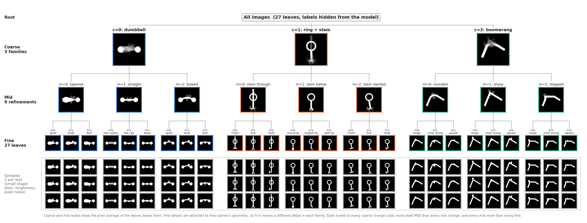
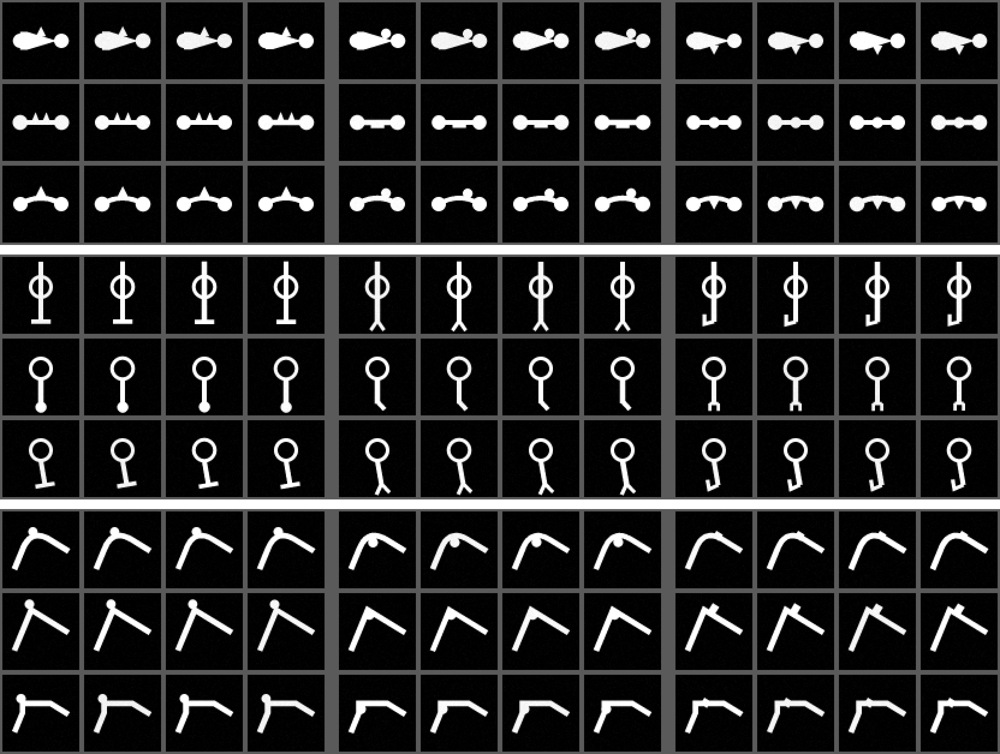

# Report: Hierarchical synthetic image dataset, v2 (Experiment 1 data)

**Prepared:** 2026-11-02.  
**Status:** v2 generated and frozen at `/home/argha/Mat_embedding/data/synthetic_data/hierarchical_images_v2/`. **This is the dataset for Experiment 1.** v1 is kept but superseded. No autoencoder has been trained yet.  
**Builds on:** `2026_11_02_hierarchical_dataset_v1_report.md` (motivation, tree design, cost method, first tuning rounds). This report records only what changed and the v2 results.  
**Spec:** `NonLinearPB/plans/hierarchical_synthetic_data_spec.md`. **Training plan:** `NonLinearPB/plans/hierarchical_Exp1.md` (now points to v2).

## Why v2

A review of v1 raised three problems:

| Problem | Importance | What we found | v2 action |
|---|---|---|---|
| 1. Two parents have identical fine details | High | Confirmed, and the leakage probe found a **second** case. Ring "stem through" / "stem below" **and** dumbbell "tapered" / "straight" put the same three details in (almost) the same place. A fine classifier trained on one parent sorted the other perfectly (transfer 1.00). | Dumbbell "straight" and ring "stem below" get their **own** detail sets. |
| 2. Single mid pairs cheaper than single fine pairs | Medium | 8.7% of single mid pairs cost less than the costliest fine pair. **Not caused by jitter:** with jitter off the overlap was 8.1%. It came from the shapes: the weakest mid pairs (ring below vs slanted 0.016, boomerang rounded vs stepped 0.017) against the strongest fine pairs (boomerang details on the sharp bend 0.020). | Fixed in the shapes: new detail sets (which also raise the ring/dumbbell mid costs), slightly smaller boomerang bulge/square, bigger boomerang step. |
| 3. Leakage probe not run | High | Written and run on v1 and v2 (below). | Stored with the dataset in `leakage_probe/`. |

A fourth issue came out of the new single-pair overlap check, which v1 never measured:

| Problem | What we found | v2 action |
|---|---|---|
| 4. Single fine pairs cheaper than single noise pairs | With ±0.3 px jitter, 9.0% of single fine pairs cost less than the 99th-percentile noise pair (14.8% below the single costliest). **This one is caused by jitter:** noise pairs differ in jitter, matched label pairs do not. Brightness made no difference. | Jitter reduced from ±0.3 to **±0.2 px**. |

Jitter sweep used for problem 4 (60 calibration seeds; brightness ±0.05 unless noted):

| Shape jitter | Noise (× fine) | Fine pairs below costliest noise pair | Fine pairs below noise p99 |
|---|---:|---:|---:|
| ±0.3 px | 0.12 | 14.8% | 9.0% |
| ±0.3 px, no brightness change | 0.12 | 14.8% | 7.3% |
| **±0.2 px (chosen)** | 0.08 | 3.6% | **0%** |
| ±0.15 px | 0.07 | 0% | 0% |
| 0 | 0.01 | 0% | 0% |

±0.2 px was chosen as the "reduce slightly" option: it removes the overlap except at the very tail, and leaves real within-leaf variation (noise pair cost ≈ 10× the pixel-noise-only floor).

## What changed in the generator (v1 → v2)

| | v1 | v2 |
|---|---|---|
| Dumbbell "straight" fine details | spike / knob / keel (same as tapered, bowed) | **twin spikes** (two small spikes, one each side of the midpoint) / **flat cap** (bar under the connector) / **bead** (disk threaded on the connector) |
| Ring "stem below" fine details | T-foot / fork / hook (same as through, slanted) | **round tip** (disk at the stem end) / **angled tip** (stem end bends to one side) / **split tip** (two parallel prongs on a short crossbar) |
| Boomerang bulge radius / square side | 4.0 / 6.5 | 3.8 / 6.2 |
| Boomerang step | 46% of each arm | 52% |
| Shape jitter | ±0.3 px | **±0.2 px** |
| Everything else | — | unchanged: sizes, seeds (train 1001, val 2002, test 3003, calibration 4004), split sizes, brightness ±0.05, noise σ = 0.01, no translation |

`FINE_NAMES` is now indexed `[c][m][f]`. New `GEOM` entries: `c0.twin = (2.6, 6.5, 4.5)` (half-base, height, offset), `c0.cap = (5.5, 3.0)` (half-width, thickness), `c0.bead_r = 4.5`, `c1.round_tip_r = 4.5`, `c1.angled_tip = (6.0, 5.0, 3.5)` (side, down, thickness), `c1.split_tip = (3.5, 6.0, 2.5)` (half-gap, length, thickness).

## The v2 tree



<small>Figure: /home/argha/Mat_embedding/code/NonLinearPB/NonLinearPBMeetingNotes/assets/2026_11_02_hier_v2_tree.png. Coarse and mid nodes show the pixel average of their leaves. Bottom block: 3 samples per leaf with the v2 nuisance (±0.2 px jitter, brightness, pixel noise).</small>

| Coarse `c` | Mid `m` | Fine `f` = 0 / 1 / 2 |
|---|---|---|
| 0 dumbbell | 0 tapered | spike / knob / keel |
| | 1 straight | **twin spikes / flat cap / bead** |
| | 2 bowed | spike / knob / keel (at the bow's apex) |
| 1 ring + stem | 0 stem through | T-foot / fork / hook |
| | 1 stem below | **round tip / angled tip / split tip** |
| | 2 stem slanted | T-foot / fork / hook (at the slanted foot) |
| 2 boomerang | 0 rounded / 1 sharp / 2 stepped | bulge / inner bump / square (at each bend) |

## Results for the frozen v2

Cost method unchanged from v1: pixel MSE on [0, 1] images, matched pairs with one label changed and the same nuisance seed, 2,700 pairs per level from 100 calibration seeds (seed 4004, never train/val/test).

### Cost ladder

| Level | $\Delta$ (mean pixel MSE) | 95% CI | Ratio to fine | Range of single pairs | v1 ratio |
|---|---:|---:|---:|---|---:|
| Coarse | 0.1203 | ± 0.0006 | **9.34** | 0.069 – 0.155 | 8.35 |
| Mid | 0.0382 | ± 0.0004 | **2.96** | 0.020 – 0.061 | 2.39 |
| Fine | 0.0129 | ± 0.0002 | **1.00** | 0.0042 – 0.0192 | 1.00 |
| Noise | 0.0011 | ± 0.00003 | **0.08** | 0.00007 – 0.0043 | 0.14 |

Coarse : mid is 3.1 (v1: 3.5; target ~2). Noise is well under the 0.25 × fine limit.

### Single-pair overlap (new check, stored in `config.json` → `cost_ladder.single_pair_overlap`)

| Adjacent levels | Cheapest upper pair | Costliest lower pair | Upper pairs below costliest lower pair | P(random upper pair < random lower pair) | v1 |
|---|---:|---:|---:|---:|---|
| coarse vs mid | 0.0688 | 0.0610 | **0%** | 0 | 0% |
| mid vs fine | 0.0201 | 0.0192 | **0%** | 0 | 8.7% / 0.60% |
| fine vs noise | 0.0042 | 0.0043 | **0.26%** (7 of 2,700) | 0.0001% | not measured (≈ 15% at ±0.3 px) |

### Per sibling pair (mean over 300 matched pairs; fine pairs averaged over the family's three parents)

| Coarse pair | Cost | × fine |
|---|---:|---:|
| dumbbell vs ring + stem | 0.1314 | 10.19 |
| dumbbell vs boomerang | 0.1060 | 8.22 |
| ring + stem vs boomerang | 0.1236 | 9.59 |

| Family | Mid pair | Cost | × fine |
|---|---|---:|---:|
| dumbbell | tapered vs straight | 0.0313 | 2.43 |
| dumbbell | tapered vs bowed | 0.0473 | 3.67 |
| dumbbell | straight vs bowed | 0.0438 | 3.40 |
| ring + stem | through vs below | 0.0369 | 2.86 |
| ring + stem | through vs slanted | 0.0491 | 3.81 |
| ring + stem | below vs slanted | 0.0240 | 1.86 |
| boomerang | rounded vs sharp | 0.0292 | 2.26 |
| boomerang | rounded vs stepped | 0.0311 | 2.41 |
| boomerang | sharp vs stepped | 0.0510 | 3.96 |

| Family | Fine pair (index) | Cost | × fine |
|---|---|---:|---:|
| dumbbell | f0 vs f1 | 0.0159 | 1.23 |
| dumbbell | f0 vs f2 | 0.0125 | 0.97 |
| dumbbell | f1 vs f2 | 0.0132 | 1.02 |
| ring + stem | f0 vs f1 | 0.0143 | 1.11 |
| ring + stem | f0 vs f2 | 0.0100 | 0.78 |
| ring + stem | f1 vs f2 | 0.0135 | 1.05 |
| boomerang | bulge vs inner bump | 0.0143 | 1.11 |
| boomerang | bulge vs square | 0.0125 | 0.97 |
| boomerang | inner bump vs square | 0.0098 | 0.76 |

The two new detail sets are weaker than the others:

| Parent | Fine pair | Cost | × fine |
|---|---|---:|---:|
| dumbbell straight | twin spikes vs flat cap | 0.0129 | 1.00 |
| dumbbell straight | twin spikes vs bead | 0.0113 | 0.88 |
| dumbbell straight | **flat cap vs bead** | **0.0048** | **0.37** |
| ring stem below | round tip vs angled tip | 0.0107 | 0.83 |
| ring stem below | round tip vs split tip | 0.0070 | 0.54 |
| ring stem below | angled tip vs split tip | 0.0063 | 0.49 |

| Family | Noise (same leaf, two seeds) | × fine |
|---|---:|---:|
| dumbbell | 0.0012 | 0.09 |
| ring + stem | 0.0014 | 0.11 |
| boomerang | 0.0006 | 0.04 |

### Conditional-variance check (training images)

| Known up to | Groups | MSE of predicting by group mean | Error saved by this level | v1 |
|---|---:|---:|---:|---:|
| nothing (root) | 1 | 0.0451 | — | 0.0453 |
| coarse | 3 | 0.0147 | **0.0304** | 0.0306 |
| mid | 9 | 0.0048 | **0.0099** | 0.0091 |
| leaf (fine) | 27 | 0.0005 | **0.0043** | 0.0048 |

0.0304 > 0.0099 > 0.0043 > 0.0005 left over: same order as the cost ladder. These are also the reference values for reading Experiment 1's reconstruction-error-vs-k curves: test MSE near 0.0147 means the code holds about the family; near 0.0048, family + mid; near 0.0005, the leaf. Pixel noise alone sets a floor of about 0.0001.

### Leakage probe

Code: `NonLinearPB/NonLinearPBExperiments/scripts/leakage_probe_hier.py`. Output: `hierarchical_images_v2/leakage_probe/` (`leakage_matrix.csv`, `leakage_summary.json`).

**Question:** can a fine-label classifier fitted inside one parent `(c, m)` also sort the fine labels of a different parent? If so, a shared pixel feature carries the fine label across parents.

**Method:** for each of the 9 parents, a multinomial logistic regression on the 4,096 raw pixels (C = 0.1) is fit to that parent's train images (3 fine classes, 4,800 images) and scored on every parent's val images (600 each). Fine indices are arbitrary across parents, so the score is the **best accuracy over the 6 relabelings** of the target's classes. Chance is 1/3; 0.67 means one of the three details is recognisable in the target parent; 1.00 means all three transfer. Train and val only; test is never touched.

v1 → v2, best-permutation transfer (rows: fitted on; columns: scored on; parents as `cm`, e.g. `01` = dumbbell straight):

```text
v1          00   01   02   10   11   12   20   21   22
c=0,m=0   1.00 1.00 0.67 0.33 0.33 0.33 0.33 0.33 0.33
c=0,m=1   1.00 1.00 0.67 0.34 0.33 0.33 0.67 0.33 0.33
c=0,m=2   0.33 0.33 1.00 0.36 0.33 0.33 0.33 0.33 0.33
c=1,m=0   0.38 0.35 0.35 1.00 1.00 0.33 0.41 0.38 0.37
c=1,m=1   0.33 0.33 0.33 1.00 1.00 0.33 0.33 0.33 0.33
c=1,m=2   0.34 0.34 0.35 0.67 0.67 1.00 0.34 0.36 0.36
c=2,m=0   0.33 0.67 0.33 0.34 0.33 0.33 1.00 0.33 0.33
c=2,m=1   0.33 0.33 0.33 0.33 0.33 0.33 0.33 1.00 0.33
c=2,m=2   0.33 0.33 0.33 0.33 0.33 0.33 0.33 0.67 1.00

v2          00   01   02   10   11   12   20   21   22
c=0,m=0   1.00 0.67 0.67 0.33 0.33 0.33 0.33 0.33 0.33
c=0,m=1   0.67 1.00 0.33 0.33 0.33 0.33 0.33 0.33 0.33
c=0,m=2   0.33 0.33 1.00 0.36 0.33 0.33 0.33 0.33 0.33
c=1,m=0   0.33 0.33 0.34 1.00 0.33 0.33 0.33 0.34 0.33
c=1,m=1   0.33 0.33 0.33 0.33 1.00 0.67 0.33 0.33 0.33
c=1,m=2   0.34 0.34 0.37 0.67 0.67 1.00 0.34 0.36 0.36
c=2,m=0   0.33 0.67 0.33 0.33 0.33 0.33 1.00 0.33 0.33
c=2,m=1   0.33 0.33 0.33 0.33 0.33 0.33 0.33 1.00 0.33
c=2,m=2   0.33 0.33 0.33 0.33 0.33 0.33 0.33 0.67 1.00
```

| | v1 | v2 |
|---|---|---|
| Same parent (diagonal) | 1.00 (all learnable) | 1.00 |
| Full transfer (1.00) between different parents | **4** (dumbbell tapered ↔ straight, ring through ↔ below) | **0** |
| Partial transfer (0.67), same family | 5 | 7 |
| Partial transfer (0.67), other family | 2 | 1 (boomerang rounded → dumbbell straight) |
| Mean transfer, same family / other family | 0.57 / 0.35 | 0.46 / 0.34 |

**Decision:** freeze v2 with the 0.67 cells documented, not removed. They mean one detail of a parent occupies a pixel region that also separates one class in another parent (for example, ink below the dumbbell connector: keel under "tapered", flat cap under "straight"). Removing them all would mean giving all 9 parents their own detail sets, which is a redesign. The spec asks to document partial leakage rather than assume it away.

### Integrity checks

| Check | Result |
|---|---|
| Split sizes | 43,200 train / 5,400 val / 5,400 test; exactly 1,600 / 200 / 200 per leaf |
| Seeds reused across splits | none |
| Duplicate images within a split / shared across splits | 0 / 0 |
| Reproducibility | all three npz files and the leakage matrix are byte-identical to the candidate run `data_2026_11_02__11_39_47` |

### Contact sheet (training images)



<small>Figure: /home/argha/Mat_embedding/code/NonLinearPB/NonLinearPBMeetingNotes/assets/2026_11_02_hier_v2_contact_sheet.png. Rows: the 9 `(c, m)` parents. Columns: 3 fine leaves × 4 training samples.</small>

## Caveats

1. **The new detail sets are weaker.** Dumbbell-straight flat cap vs bead costs 0.0048 (0.37 × the average fine pair), and the ring-below tips cost 0.006–0.011. They still sit above noise on average (noise mean 0.0011), but they are the source of the 7 single fine pairs cheaper than the costliest noise pair. Expect these two parents' fine leaves to be the hardest to separate in Experiment 1. Report fine-level results per parent, not only pooled.
2. **Partial leakage remains** (0.67 cells above). Within-family partial transfer is expected when details sit on similar parts; the one cross-family cell is boomerang rounded → dumbbell straight.
3. **Coarse is still above target** (9.3 vs ~4 × fine; 3.1 × mid instead of 2×). Accepted, as in v1.
4. **Costs are nested.** A coarse pair also changes mid and fine; a mid pair also changes fine, including, for dumbbell straight and ring below, switching to a different detail set.
5. **Noise differs by family** (boomerang about half of the other two). Compare same-leaf distances within a family or normalise per family.
6. **Test seed unchanged** (3003). Test images were never used in any tuning or probe; trial-run folders contain identical copies of v2's `test.npz` (`data_2026_11_02__11_39_47`).
7. **Train with pixel MSE.** The ladder was calibrated in MSE.

## Files

### Dataset (outside git)

`/home/argha/Mat_embedding/data/synthetic_data/hierarchical_images_v2/`

| File | Contents |
|---|---|
| `train.npz`, `val.npz`, `test.npz` | keys `images` (N × 64 × 64 uint8), `coarse`, `mid`, `fine`, `leaf_id` (= 9c + 3m + f), `nuisance_seed` |
| `metadata.csv` | one row per image |
| `cost_validation.csv`, `conditional_variance.csv` | cost tables |
| `leakage_probe/leakage_matrix.csv`, `leakage_probe/leakage_summary.json` | leakage probe |
| `contact_sheet.png` | 9 parents × (3 leaves × 4 samples) |
| `config.json` | version `v2`, `frozen: true`, seeds, nuisance (jitter 0.2), cost ladder incl. single-pair overlap, integrity, SHA-256, names `[c][m][f]` |
| `README.md` | regeneration command |

SHA-256:

```text
58ba0feb6553701f38a740b17e79017c111d91f475db04de7299ffa5430f0570  train.npz
9e2606403a71754cd8e3019b4270702303654d8691f8065e32379c3d6ca4593c  val.npz
8ddc61727e97eafbc3b7194bbc2fabaec8dd64c77bf497fa6aef2236d8d1ac91  test.npz
```

Loading:

```python
import numpy as np
d = np.load("/home/argha/Mat_embedding/data/synthetic_data/hierarchical_images_v2/train.npz")
x = d["images"].astype(np.float32) / 255.0      # (43200, 64, 64)
c, m, f, leaf = d["coarse"], d["mid"], d["fine"], d["leaf_id"]
```

### Other versions and runs (kept)

- `data/synthetic_data/hierarchical_images_v1/`: frozen v1, superseded.
- `files/results/hier_synthetic_pilot/`:
  - `data_2026_11_02__10_37_58/`: v1 draft renderer.
  - `data_2026_11_02__10_44_09/`: v1 tuned (= v1).
  - `data_2026_11_02__11_37_37/`: v2 shapes with ±0.3 px jitter (includes `leakage_probe/`).
  - `data_2026_11_02__11_39_47/`: v2 candidate (= v2, includes `leakage_probe/`).
  - `leakage_v1/`: leakage probe on frozen v1.
  - `tree_*`: tree figures; `tree_v2_final/` is the v2 figure.

### Code (in git, not yet committed)

| File | Role |
|---|---|
| `NonLinearPB/NonLinearPBExperiments/hier_synthetic/render.py` | renderer; `GEOM`, `FINE_NAMES[c][m][f]`, `JITTER_PX = 0.2` |
| `NonLinearPB/NonLinearPBExperiments/scripts/generate_hier_dataset.py` | `VERSION = "v2"`; adds the single-pair overlap check; `--final` refuses to overwrite |
| `NonLinearPB/NonLinearPBExperiments/scripts/leakage_probe_hier.py` | leakage probe (`--data <folder>`) |
| `NonLinearPB/NonLinearPBExperiments/scripts/run_hier_dataset_tmux.sh` | tmux launcher |
| `NonLinearPB/NonLinearPBExperiments/scripts/plot_hier_tree.py` | tree figure |

### Reproduce (from `/home/argha/Mat_embedding/code`)

```bash
bash NonLinearPB/NonLinearPBExperiments/scripts/run_hier_dataset_tmux.sh --final     # refuses if v2 exists
python NonLinearPB/NonLinearPBExperiments/scripts/leakage_probe_hier.py --data /home/argha/Mat_embedding/data/synthetic_data/hierarchical_images_v2
python NonLinearPB/NonLinearPBExperiments/scripts/plot_hier_tree.py
```

Environment: `mrl_env_cuda12` (Python 3.10, NumPy 2.2.6, Pillow 12.1.1, scikit-learn 1.7.2). Generation: 57.5 s on CPU.

## Next steps

1. Train the standard CNN-AE and the full-prefix CNN-MRL-AE (5 seeds each) on v2 with pixel MSE, per `hierarchical_Exp1.md`.
2. Use the conditional-variance values above as reference lines on the reconstruction-vs-k plots.
3. Report fine-level probes per parent, flagging dumbbell straight and ring below (caveat 1).
